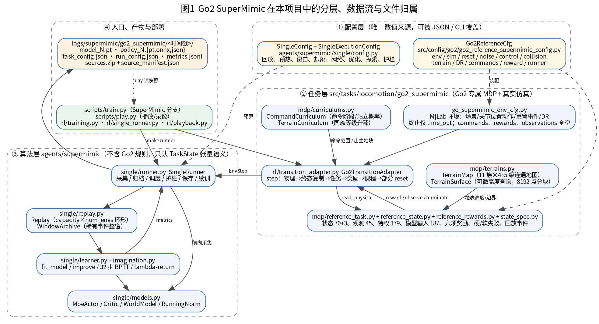
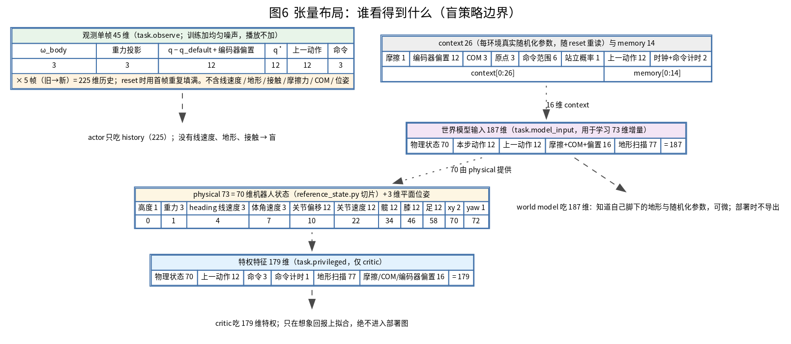
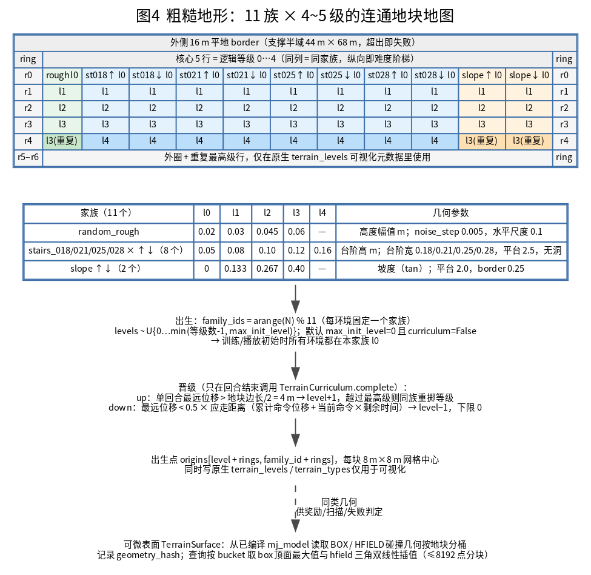
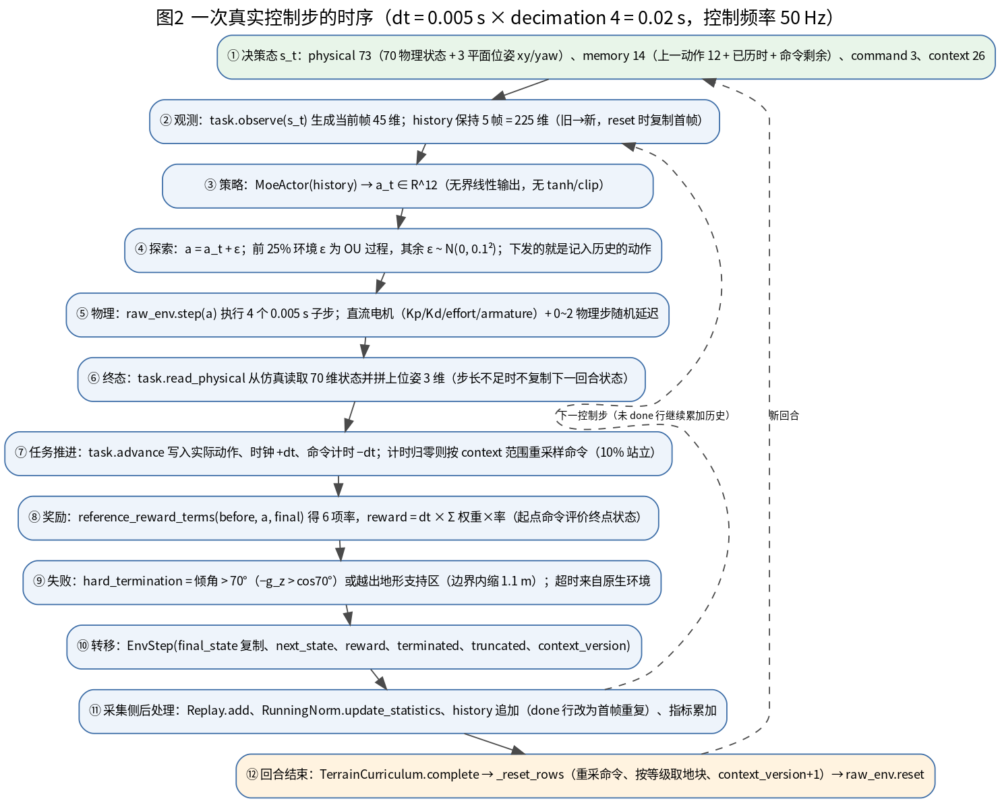
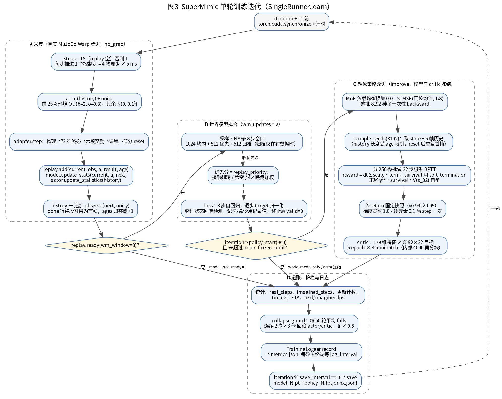
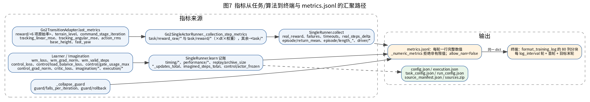
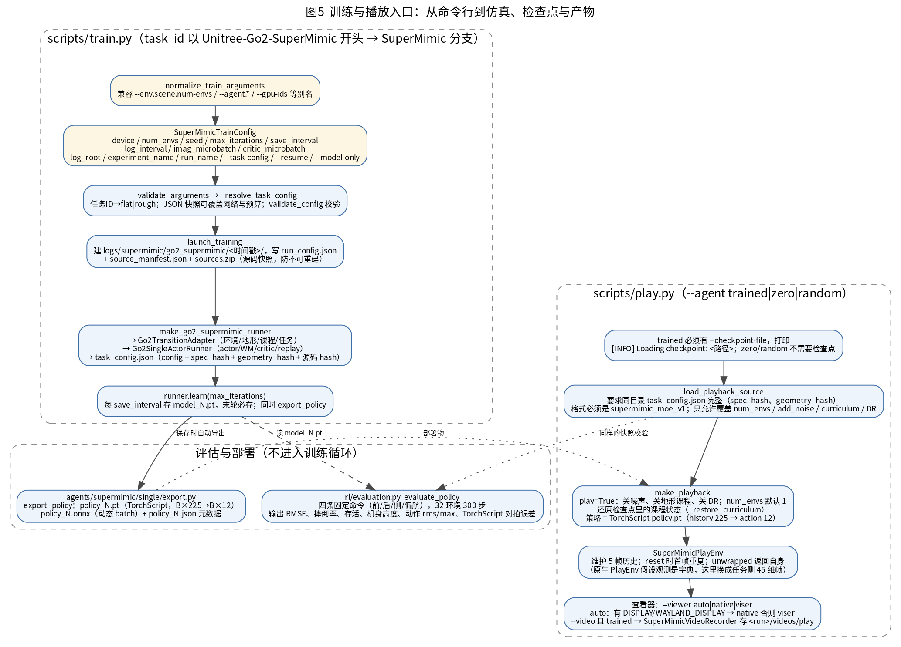

<!-- Copyright (c) 2026-2027 zh -->

# Go2 SuperMimic 子系统详细分析

本文分析 `Unitree-Go2-SuperMimic-Flat` / `-Rough` 两个任务的完整实现：MDP 各要素（状态、观测、特权、动作、命令、奖励、终止、重置、随机化、地形、课程）、三张网络的结构与参数规模、想象训练与 λ-return、回放与稀有事件归档、塌缩护栏、检查点与导出、终端与 JSONL 日志设计、train/play/评估入口。附件含 7 张流程图。

分析对象是当前工作区的 `moe_history` 构建；文中每个判断都标明依据类型。

## 0. 阅读约定与依据分层

| 标记 | 含义 |
| --- | --- |
| **本项目已验证事实** | 在本工作区代码/配置/实际运行产物中直接读到或实际跑出，可复查 |
| **论文依据** | 出自本地 [SuperMimic 英文 v1](../../paper/SuperMimic_2610.28480v1.pdf) 或中文笔记 [SuperMimic阅读笔记](../../paper/SuperMimic阅读笔记.md)，标注章节/表号 |
| **参考项目依据** | 出自 `Zhengtianjin/go2-supermimic@d9eee9b3`、`wty-yy/go2_rl_gym@30e74dc` 的对应实现，本地经 [NOTICE](../../agents/supermimic/single/NOTICE.md) 与对照测试核对 |
| **推断／待验证假设** | 由上述事实推导、尚未实测；给出最小验证方法 |

证据来源与时间边界：

- 代码事实来自当前工作区（`git revision 291995eb`，工作区有未提交修改，见运行目录 `run_config.json`）。
- 运行事实来自**当前 MoE 构建**的训练目录 `logs/supermimic/go2_supermimic/2026-10-27_19-28-11_197179/`（PID 499718，`Unitree-Go2-SuperMimic-Flat --num-envs 1024`，格式 `supermimic_moe_v1`）。训练指标固定在该目录 **iteration 3043 / 会话 83.7 min / real_steps 3 131 392**（`metrics.jsonl` 共 3043 条记录），这也是该 run 的**最后一条记录**：`max_iterations=10000`，实际在 3043 轮结束，最后一个检查点是 `model_3000.pt`（20:50 写出，`policy.json` 的 `iteration=3000`）。进程已不在运行，**结束原因未查明**——`metrics.jsonl` 里 3043 条记录全部完整（60 键）、`guard/rollback` 从未出现、最后一条记录的指标正常（`raw track_linear` 0.4944、`raw track_angular` 0.8173），没有数值异常或护栏触发的痕迹。终端日志块取样自同目录的早期迭代（iteration 1 与 1500），因此**终端块里的数字与 3043 快照不同属正常**，只是取样时点不同。
- 另有旧目录 `logs/supermimic/go2_supermimic/2026-10-27_14-41-21_092524/`（1560 轮，格式 `supermimic_single_mlp_v1`，MoE 之前的历史构建）。它只能作为**历史对照**，不代表当前代码，文中凡引用均显式标注。
- 单元测试 `tests.test_tasks.test_reference_supermimic_task` + `tests.test_agents.test_reference_supermimic`：`Ran 20 tests ... OK (skipped=1)`（CPU 环境）。

**不宣称训练已收敛。** 当前构建的实测表现见 §13：能力**直到 2400 轮之后才出现**，`model_3000` 已能跟踪三轴（前向 0.31、反向 −0.37、侧向 +0.52 m/s）并在 20 s 回合内 0 摔倒，但偏航在学会线速度后反而退步（RMSE 0.075 → 0.199），回合长度仍在 442~860 步间震荡。旧构建遗留的审查结论（[go2_blind_supermimic 审查 §14.11](../../docs/review/go2_blind_supermimic.md)：控制验收未通过）针对的是**只训练到 1560 轮的单 MLP 构建**，与本构建不是同一份代码、也不在同一训练时长上，不能互相代替。

本文对当前构建新增了三类此前没有的证据：**对 `model_2500` 与 `model_3000` 实跑 `evaluate_policy`**（actor 与 zero 两分支、8 s 与 20 s 两种时长）、**一组隔离实验**（固定/随机命令对照、`yaw=0` 剥离、偏航分层、弧线耦合、方向对齐；脚本与产物在 `.artifacts/supermimic-analysis/moe-run192811/`），以及**逐项核对终稿数值**（`metrics.jsonl` 的 60/61 键、参数量、奖励加和自洽性）。

写这份分析的过程中有两次判定被自己的实测推翻，都保留在文中而不是悄悄改掉：

1. 先按 2500 轮的数据判定“只学会偏航、线速度完全没学到”，隔离实验确认了这一点（§13.2）；但同一次训练到 3000 轮后线速度**确实学会了**（§13.1b、§13.3）。结论因此从“线速度跟踪失败”修正为“**线速度能力出现得晚（约 2500 轮之后）**”，并在 §15 与旧单 MLP 构建（只跑到 1560 轮）做了时长归因，而不是结构归因。
2. 中期曾把 `raw track_linear` 的上涨读成“线速度开始进步”；隔离实验证明那是偏航耦合造成的度量假象（§13.2）。这条误读本身成为一个可复用的方法论教训：**单看指标曲线不足以判断能力，必须做分层/隔离测量**。

## 1. 系统总览



四层职责（**本项目已验证事实**）：

| 层 | 位置 | 职责 | 不做什么 |
| --- | --- | --- | --- |
| 配置层 | [go2_reference_supermimic_config.py](../../src/config/go2/go2_reference_supermimic_config.py)、[single/config.py](../../agents/supermimic/single/config.py) | 唯一数值来源，可被 `--task-config` JSON 与 CLI 覆盖 | 不含执行逻辑 |
| 任务层 | [src/tasks/locomotion/go2_supermimic/](../../src/tasks/locomotion/go2_supermimic/) | Go2 专属 MDP、地形、课程、真实仿真装配 | 不含算法更新逻辑 |
| 算法层 | [agents/supermimic/](../../agents/supermimic/) | 只认 `TaskState` 张量语义；网络、想象、回放、护栏、保存 | 不硬编码任何 Go2 常量 |
| 入口层 | [scripts/train.py](../../scripts/train.py)、[scripts/play.py](../../scripts/play.py)、[rl/](../../src/tasks/locomotion/go2_supermimic/rl/) | 装配、日志目录、快照、播放、导出 | 不承载核心实现 |

关键的架构选择：MjLab 原生环境的 `observations`、`commands`、`rewards`、`curriculum`、`metrics` **全部置空**，只保留 `time_out` 一个终止项（[go_supermimic_env_cfg.py:116-122](../../src/tasks/locomotion/go2_supermimic/go_supermimic_env_cfg.py#L116-L122)）。所有 MDP 语义集中到 `Go2ReferenceTaskModel` 一处，真实采集与想象 rollout **共用同一份实现**，因此不存在“训练用奖励和想象用奖励不一致”“真实与想象观测语义不同”这类分叉风险。代价是原生管理器的大部分能力（自动观测拼接、原生课程、原生 metrics）都不可用，全部由 adapter 手工完成。

## 2. MDP：状态、观测与特权特征



### 2.1 physical：73 维状态向量

`TaskState` 只有四个字段（[interfaces.py:47-64](../../agents/supermimic/interfaces.py#L47-L64)）：`physical [N,73]`、`memory [N,14]`、`command [N,3]`、`context [N,26]`。`physical` 的切片定义在 [reference_state.py:8-19](../../src/tasks/locomotion/go2_supermimic/mdp/reference_state.py#L8-L19)：

| 切片 | 维度 | 内容 | 来源 |
| --- | --- | --- | --- |
| `HEIGHT` 0:1 | 1 | 机身高度，`root_z − surface_height(xy)` | `read_physical` |
| `GRAVITY` 1:4 | 3 | 机体系重力投影 | `data.projected_gravity_b` |
| `VELOCITY_HEADING` 4:7 | 3 | heading 系 `vx, vy, vz`（**真实线速度**，含垂向） | `yaw_rotate_inverse(root_lin_vel_w)` |
| `ANGULAR_BODY` 7:10 | 3 | 机体系角速度 | `root_ang_vel_b` |
| `JOINT_OFFSET` 10:22 | 12 | `q − q_default` | `joint_pos − default` |
| `JOINT_VELOCITY` 22:34 | 12 | `q̇` | `joint_vel` |
| `HIPS` 34:46 | 12 | 4×髋 body 在机体系相对位置 | `body_link_pos_w` |
| `KNEES` 46:58 | 12 | 4×膝 body 相对位置 | 同上 |
| `FEET` 58:70 | 12 | 4×足 site 相对位置 | `site_pos_w` |
| `POSE` 70:73 | 3 | 世界系 `x, y, yaw` | `root_link_pos_w`、`heading_w` |

`read_physical` 见 [reference_task.py:83-95](../../src/tasks/locomotion/go2_supermimic/mdp/reference_task.py#L83-L95)。**关节顺序固定为 FL/FR/RL/RR × hip/thigh/calf**（[state_spec.py:4](../../src/tasks/locomotion/go2_supermimic/mdp/state_spec.py#L4)），且 adapter 在初始化时实际校验资产关节序与动作项 target 序（[transition_adapter.py:53-58](../../src/tasks/locomotion/go2_supermimic/rl/transition_adapter.py#L53-L58)），不匹配直接报错——这是防“训练/部署关节错位”的硬约束。

### 2.2 observation：45 维盲本体帧

[reference_task.py:141-148](../../src/tasks/locomotion/go2_supermimic/mdp/reference_task.py#L141-L148)：

```
observe(s) = [ ω_body(3) , gravity_body(3) , (q−q0)+encoder_bias(12) , q̇(12) , a_prev(12) , command(3) ] = 45
```

**没有任何线速度、地形、接触、摩擦、COM、位姿、相位输入。** 线速度只能经 5 帧历史隐式估计——这就是“盲”（blind）的确切含义。命令之外的 3 维偏航项是 `ω_z` 的世界系目标，因为 heading 系与世界系仅差 yaw 旋转，`ω_z` 在两系中数值相同（[reference_state.py:51-54](../../src/tasks/locomotion/go2_supermimic/mdp/reference_state.py#L51-L54)）。

噪声：`add_noise=True` 时对**前 30 维**加对称均匀噪声，后 15 维（`a_prev`+`command`）噪声幅度恒为 0（[reference_task.py:55-57](../../src/tasks/locomotion/go2_supermimic/mdp/reference_task.py#L55-L57) 的 15 个零 + [observe](../../src/tasks/locomotion/go2_supermimic/mdp/reference_task.py#L146-L147)）。幅度（[config:72-79](../../src/config/go2/go2_reference_supermimic_config.py#L72-L79)）：`ω 0.2`、`gravity 0.05`、`q 0.01`、`q̇ 1.5`，再乘 `noise_level=1.0`。**噪声只在新生成帧上加**，历史帧不重复加噪（采集侧每步只 `observe` 一次）。

### 2.3 history：225 = 45 × 5

`history` 形状 `[N, 5, 45]`，帧序**旧→新**（`history_order = "frame_major_oldest_first"`），展平后 225 维直接进混专家编码器。reset 时用首帧复制填满（[runner.py:123-124](../../agents/supermimic/single/runner.py#L123-L124)、[runner.py:176](../../agents/supermimic/single/runner.py#L176)），避免“零填充”引入分布外输入。

历史帧数被硬性约束为 5（[go_supermimic_env_cfg.py:41-42](../../src/tasks/locomotion/go2_supermimic/go_supermimic_env_cfg.py#L41-L42)），因为 `go2_rl_gym` 预训练权重按 5 帧训练；改帧数会使 `load_pretrained` 严格加载失败。

### 2.4 privileged：179 维（仅 critic）

[reference_task.py:136-139](../../src/tasks/locomotion/go2_supermimic/mdp/reference_task.py#L136-L139)：

```
privileged = [ physical[0:70](70) , a_prev(12) , command(3) , command_timer(1) , terrain_scan(77) , simulation_context(16) ] = 179
```

- 含**真实线速度**与**地形扫描**，critic 因此能“看见”策略看不见的量，承担非对称 actor-critic 的信息差。
- `simulation_context = [friction(1), COM(3), encoder_bias(12)] = 16`（[reference_task.py:120-124](../../src/tasks/locomotion/go2_supermimic/mdp/reference_task.py#L120-L124)）。参考实现只给 4 维（摩擦+COM），本项目的 12 维编码器偏置是**有意偏离**：MjLab 的 `JointPositionAction` 在下发前会减去 `encoder_bias`（`.venv/.../mjlab/envs/mdp/actions/actions.py:222-223`），而观测里的关节角是**加了**偏置的编码器读数，所以真实物理目标依赖偏置——模型必须知道它才能拟合转移动力学。这一点已由测试覆盖。
- `terrain_scan[77]` 的每个分量是 `world_position.z − surface_height(该扫描点)`，即**机身（或其预测）相对每个测点的地形高差**，不是机身绝对高度，也不是“地表相对机身”。`world_position.z` 在推理/想象时由 `base_height + surface_height(xy)` 还原（[reference_task.py:97-102](../../src/tasks/locomotion/go2_supermimic/mdp/reference_task.py#L97-L102)），所以平地模式下 77 维全等于机身高度——信息高度冗余；只有 rough 模式才携带真正的地形形状。见 §5.3。

### 2.5 model input：187 维（世界模型）

[reference_task.py:126-128](../../src/tasks/locomotion/go2_supermimic/mdp/reference_task.py#L126-L128)：

```
model_input = [ physical[0:70](70) , action(12) , a_prev(12) , context16 , scan(77) ] = 187
```

注意 `model_input` **不含** `command`/`timer`，命令作为外生过程从记录里回喂（§2.6、§4）。训练时走 `supervised_model_input`（[reference_task.py:130-134](../../src/tasks/locomotion/go2_supermimic/mdp/reference_task.py#L130-L134)）：扫描值改为“记录位姿处地形 relief + 自回归预测的机身高度”，即让高度与扫描在训练时口径一致。

### 2.6 memory 与 context 的 26 槽

`memory[14]`：`a_prev(0:12)`、`elapsed_time(12)`、`command_timer(13)`。
`context[26]`（[state_spec.py:9-15](../../src/tasks/locomotion/go2_supermimic/mdp/state_spec.py#L9-L15)）：`friction(0)`、`encoder_bias(1:13)`、`COM(13:16)`、`origin(16:19)`、`ranges(19:25)`、`zero_probability(25)`。

`origin/ranges/zero_probability` 只被任务模型用于命令采样，不进网络输入；`friction/COM/bias` 进 16 维 `simulation_context`。真实值读取见 [transition_adapter.py:135-148](../../src/tasks/locomotion/go2_supermimic/rl/transition_adapter.py#L135-L148)：摩擦取自 `geom_friction`，COM 偏移 = 实际 `body_ipos − MJCF 标称 ipos`。

## 3. 动作与执行器

### 3.1 动作语义

- 策略输出 12 维**无界线性**输出，无 tanh、无 clip、无动作限幅配置项（**本项目已验证事实**；`Mlp` 最后一层是裸 `nn.Linear`，见 [models.py:47-62](../../agents/supermimic/single/models.py#L47-L62)）。下发动作同时被写入 `memory.a_prev`，成为下一步观测的一部分——**动作历史闭环**是真实/想象一致的必要条件。
- 关节目标：`q_target = q_default + a ⊙ scale − encoder_bias`。**下发链路里没有对 `q_target` 做软限位裁剪**：`JointPositionActionCfg` 未设 `clip`（[go_supermimic_env_cfg.py:68-75](../../src/tasks/locomotion/go2_supermimic/go_supermimic_env_cfg.py#L68-L75)），`set_joint_position_target` 直接写入 `joint_pos_target`（`.venv/.../mjlab/entity/entity.py:1054-1072`），PD 力矩由 `dc_motor_clip` 按 `saturation_effort` 与转速-力矩曲线限幅（`.venv/.../mjlab/actuator/dc_actuator.py:126-135`）。软限位只在两处出现：`reset_joints_by_offset` 的初始位置裁剪（`.venv/.../mjlab/envs/mdp/events.py:297-298`）与任务模型的 `joint_pos_limits` 惩罚项（后者用的正是 `soft_joint_pos_limits`，见 [transition_adapter.py:65](../../src/tasks/locomotion/go2_supermimic/rl/transition_adapter.py#L65)）。所以“越界”在物理上是允许的，只是要付奖励代价——这是**本项目已验证事实**，也是 §7.1 里 `joint_pos_limits` 权重 −2 的实际作用方式。
- 动作尺度 `scale = 0.25 · effort_limit / Kp`（**参考项目依据**，[config:108-109](../../src/config/go2/go2_reference_supermimic_config.py#L108-L109)）：hip/thigh `0.33490`、calf `0.28532`。

### 3.2 直流电机参数

`Kp = I_rotor · (10·2π)²`、`Kd = 4·I_rotor·ω`（**参考项目依据**）：

| 量 | hip / thigh | calf |
| --- | --- | --- |
| 转子惯量（含传动比 6.33，膝再 ×1.5） | 0.0044814 | 0.0100831 |
| `Kp` | 17.6918 | 39.8066 |
| `Kd` | 1.1263 | 2.5342 |
| `effort_limit` | 23.7 N·m | 45.43 N·m |
| `saturation_effort` | 2× = 47.4 | 2× = 90.86 |
| `armature` | 0.0044814 | 0.0100831 |
| `action = 1` 时的 PD 力矩 | 5.925 N·m（= 0.25×23.7） | 11.3575 N·m（= 0.25×45.43） |
| 力矩达到 `effort_limit` 所需的动作 | 1.3396 | 1.1413 |

`delay_min_lag=0, delay_max_lag=2, delay_update_period=1, delay_hold_prob=0.0`：每个控制步重抽 0~2 个物理步的延迟，即最多 10 ms，属于轻量执行延迟。

### 3.3 控制频率

`sim.timestep=0.005 s × decimation 4 = 0.02 s`，控制频率 50 Hz；`episode_length_s=20.0` → **1000 控制步/回合**。`dt=0.02` 同时是奖励乘子、命令计时步长、critic 折扣的物理时间单位。

## 4. 命令设计

[config:177-188](../../src/config/go2/go2_reference_supermimic_config.py#L177-L188)、[reference_task.py:152-159](../../src/tasks/locomotion/go2_supermimic/mdp/reference_task.py#L152-L159)：

- 命令 = `(vx, vy)` 在**航向系** + `ω_z` 在**世界系**（论文附录 G 速度接口，**论文依据**）。
- 每回合/每次过期从 `U(-1.5,2.0) × U(-1.32,1.32) × U(-3.35,3.35)` 独立均匀采样；`zero_probability=0.1` 时以 10% 概率整体置零（站立）。
- 过期时间 `U(5.0,5.0)` → 固定 5 s 重采样一次，20 s 回合内约 4 段命令。
- `heading_command=False`：不使用“朝向误差→角速度”的间接命令，直接给 `ω_z`。
- `stages=[]`：不做课程式命令扩张（参考仓库的多阶段命令未启用）。

命令以 `context.ranges` 形式存于每环境上下文，`CommandCurriculum.parameters()` 还会按地形家族把上界裁剪为 `terrain_limits[family]`（[curriculums.py:44-59](../../src/tasks/locomotion/go2_supermimic/mdp/curriculums.py#L44-L59)）；`terrain_limits` 只有 4 个键（`flat`/`stairs`/`slope`/`random_rough`），11 个家族按前缀归并到这 4 类（[curriculums.py:50-53](../../src/tasks/locomotion/go2_supermimic/mdp/curriculums.py#L50-L53)）；4 个键的值都是 `(2.0, 1.32, 3.35)`，与 `initial_ranges` 完全一致，**因此当前裁剪是恒等变换**（**本项目已验证事实**）。

外部驱动分支（`runner.driver.policy`）在默认配置下为空字符串 → `MoeCtsDriver`/`ChaseSteer` 不构造（[single_runner.py:136-148](../../src/tasks/locomotion/go2_supermimic/rl/single_runner.py#L136-L148)），所以 `driver_frac=0.25` 的“外部策略接管尾部 25% 环境”在当前运行**未生效**：`driver/*` 指标不出现，`_override_actions` 直接返回原动作。这与参考仓库不同（**参考项目依据**：其 driver 提供追逐/闪避数据），是本项目主动省略的教师/示范数据通路。

## 5. 地形设计



### 5.1 两种模式

| 模式 | 地形实体 | 地表查询 | 用途 |
| --- | --- | --- | --- |
| `flat`（任务 `-Flat` 使用） | `terrain_type="plane"` | `PlaneSurface`，`z=0`，保留零梯度（`sum*0`）以保持可微 | 平地跟踪 |
| `rough`（`-Rough`） | `generator`，7 行 × 13 列连通地块 | `TerrainSurface`，从编译后 `mj_model` 反查 BOX/HFIELD | 粗糙地形 |

### 5.2 地图几何

- 核心 `core_rows=5`（逻辑等级 0…4），`surrounding_rings=1`，共 `rows = 5+2 = 7`、`cols = 11+2 = 13`。
- 每块 `8 m × 8 m`；支撑半域 `support_half_extent = (rows, cols)·size/2 + outer_flat_width(16) = [44, 68] m`（[terrains.py:106](../../src/tasks/locomotion/go2_supermimic/mdp/terrains.py#L106)）。出界即判失败。
- 列→家族：`family_names[(col − rings) % 11]`；行→等级：`names[min(max(row−rings,0), len−1)]`（[terrains.py:112-116](../../src/tasks/locomotion/go2_supermimic/mdp/terrains.py#L112-L116)）。所以**同一列纵向就是难度阶梯**，最外圈复制边界行/列。
- 11 个家族（**本项目已验证事实**，[config:144-160](../../src/config/go2/go2_reference_supermimic_config.py#L144-L160)）：`random_rough`(4 级)、`stairs_{018,021,025,028}_outward_{up,down}`(各 5 级)、`slope_outward_{up,down}`(各 4 级)。

| 家族 | l0 | l1 | l2 | l3 | l4 | 其他几何 |
| --- | --- | --- | --- | --- | --- | --- |
| `random_rough` | 0.02 m | 0.03 | 0.045 | 0.06 | — | `noise_step 0.005`，水平尺度 0.1 |
| `stairs_*` | 0.05 m | 0.08 | 0.10 | 0.12 | 0.16 | 阶宽 0.18/0.21/0.25/0.28，平台 2.5 m，无洞 |
| `slope_*` | 0 | 0.133 | 0.267 | 0.40 | — | 坡度为 tan 值，平台 2.0 m |

`scan_size_m=(1.2,0.72)`、`scan_resolution_m=0.12` 是**遗留字段**：当前扫描网格是硬编码的 11×7（**本项目已验证事实**，用 `grep` 全仓仅命中旧 `.artifacts/` 快照）。调整这两个值不会改变网络输入——这是一个容易误判的配置陷阱。

### 5.3 可微表面与扫描

`TerrainSurface.from_model`（[terrains.py:217-309](../../src/tasks/locomotion/go2_supermimic/mdp/terrains.py#L217-L309)）：遍历已编译 `mj_model` 的碰撞 geom，按地块归属分桶，记录 `geometry_hash`（写进 checkpoint 与 `task_config.json`，播放时校验）。查询时 8192 点分块，BOX 取顶面最大值、HFIELD 做三角双线性插值。**全程只用 Torch 张量**，因此可以进 `torch.compile` 的想象图（对 `xy` 的导数为零，符合“地形是常数场”的物理事实）。

扫描网格（[reference_task.py:50-53](../../src/tasks/locomotion/go2_supermimic/mdp/reference_task.py#L50-L53)）：`x = −0.42 + 0.12·i (i<11) → −0.42…0.78`、`y = −0.36 + 0.12·j (j<7) → −0.36…0.36`，即机身前方略偏、覆盖 1.2 m × 0.72 m，**x 主序 y 次序**展平成 77 维。前置偏移 0.18 m（中心 x=0.18）体现“更关心前方落脚点”。

`surface_height` 对支撑域外返回 0 占位并置 `contains=False`（[reference_task.py:69-76](../../src/tasks/locomotion/go2_supermimic/mdp/reference_task.py#L69-L76)）；出界行在硬终止中立即判失败，所以占位值不会污染有效数据。

### 5.4 出生与晋级

- 出生：`family_ids = arange(N) % 11`（每环境固定家族），`levels ~ U{0…min(count−1, max_init_level)}`（[curriculums.py:74-95](../../src/tasks/locomotion/go2_supermimic/mdp/curriculums.py#L74-L95)）。`max_init_level=0` 且 `curriculum=False` 时，**所有环境都从本家族 l0 出生**。
- 晋级（只在回合结束时调用 `complete`）：单回合最远位移 > 地块边长/2 = 4 m → 升 1 级；最远位移 < 0.5 × 应走距离（含剩余时间内当前命令的位移）→ 降 1 级（下限 0）；越过最高级则同族随机重掷等级。
- 出生点 `origins[level + rings, family_id + rings]`，同时写原生 `terrain_levels/terrain_types`，**仅供可视化**，课程计算只有 adapter 一处（[transition_adapter.py:128-133](../../src/tasks/locomotion/go2_supermimic/rl/transition_adapter.py#L128-L133)）。

**当前训练实测**：`terrain.curriculum=False` → `TerrainCurriculum.enabled=False` → `complete` 直接返回，`task/terrain_level` **在全部 3043 条记录里恒为 0.0000**（**本项目已验证事实**）。即当前 run 是**纯平地 l0、课程关闭**的跟踪实验：`terrain_scan` 的 77 维在 `PlaneSurface` 上退化为常数倍的机身高度，地形输入实际上没有提供新信息。这也解释了为什么当前 run 在 rough 地形上的能力完全未经验证。

## 6. 一次控制步的时序



`Go2TransitionAdapter.step`（[transition_adapter.py:184-231](../../src/tasks/locomotion/go2_supermimic/rl/transition_adapter.py#L184-L231)）的顺序值得注意：**先物理、后评分**。

1. `before = state`（决策态快照）
2. `raw_env.step(a)` → 4 个 5 ms 子步
3. `read_physical` → 新的 73 维
4. `advance(before, a, physical)` → 写入 `a_prev`、时钟 `+dt`、命令计时 `−dt`，过期则重采样
5. 播放模式覆盖命令
6. `hard_termination(final)`（除非 `no_terminations`）
7. `reward_terms(before, a, final)` → **用动作前的命令评价动作后的速度**
8. `terrain_curriculum.observe(...)`
9. `command_curriculum.control_steps += 1`（播放时不加）
10. done 行：`complete(done, before.command)` 判升降级 → `_reset_rows`（重采命令、重设 origin、`raw_env.reset(env_ids)`、`context_version += 1`）

**reward 在 reset 之前算**，且 `EnvStep.final_state` 是 reset 前的副本、`next_state` 是 reset 后的新回合首帧。这样 replay 存到的是“真实发生过的转移”，而策略看到的下一个观测来自新回合——两者分别由 `final_state`/`next_state` 承载，不会把重置后的状态误当转移终点。这个区分是训练正确性的关键，测试已覆盖。

`reward = 0.02 × Σ scale·term`（[transition_adapter.py:204-205](../../src/tasks/locomotion/go2_supermimic/rl/transition_adapter.py#L204-L205)），即奖励率乘控制周期，与论文“各奖励项乘 0.02 s”一致（**论文依据**，笔记 §9.4 表 A.6 段）。

## 7. 奖励设计

### 7.1 六项奖励（严格对应论文表 A.6）

[reference_rewards.py:10-32](../../src/tasks/locomotion/go2_supermimic/mdp/reference_rewards.py#L10-L32)：

| 项 | 公式 | 权重 | 量纲 |
| --- | --- | --- | --- |
| `track_linear_velocity` | `exp(−‖v_xy − c_xy‖² / 0.25)` | +2.0 | 无量纲，∈(0,1] |
| `track_angular_velocity` | `exp(−(ω_z − c_ω)² / 0.5)` | +2.0 | 无量纲，∈(0,1] |
| `action_rate_l2` | `‖a_t − a_{t−1}‖²` | −0.3 | 平方动作单位 |
| `joint_pos_limits` | `Σ max(l−q,0) + max(q−u,0)`，`l,u` 是 **soft limits**（0.9× 关节行程） | −2.0 | rad |
| `torso_sideways_lean` | `g_y² / (g_y² + g_z²)` | −4.0 | 无量纲，∈[0,1] |
| `body_ang_vel` | `max(‖ω_b‖² − ω_z², 0)` | −0.05 | (rad/s)² |

四项设计细节：

1. **方差 0.25 = 0.5²**：线速度项分母是 `0.5²`，偏航项分母是 `0.5`（不对称）。这与表 A.6 完全一致，实现里分成两个独立配置字段 `tracking_linear_variance`/`tracking_angular_variance` 分别 = `0.25`/`0.5`（[config:193-194](../../src/config/go2/go2_reference_supermimic_config.py#L193-L194)），避免“统一方差”式的常见误抄。
2. **侧倾项不含纯俯仰**：`sideways_lean = g_y²/(g_y²+g_z²)`。若用“`1−g_z`”式的倾斜度，前倾（加速/刹车时的正常姿态）也会被罚；本实现按 heading 系 `g_y` 判定，**纯前倾不受惩罚**（[reference_rewards.py:20](../../src/tasks/locomotion/go2_supermimic/mdp/reference_rewards.py#L20) 注释明确写了这一点）。
3. **限位项用软限位**：`task.joint_limits` 来自 `robot.data.soft_joint_pos_limits`（[transition_adapter.py:65](../../src/tasks/locomotion/go2_supermimic/rl/transition_adapter.py#L65)），比 MJCF 硬限位内缩 5%（`soft_joint_pos_limit_factor=0.9`）。因此策略在到达物理限位前就会开始被罚，但**下发目标不做裁剪**（§3.1），越界是“可执行但付费”。
4. **角速度项扣掉偏航分量**：`‖ω_b‖² − ω_z²` 只惩罚滚转/俯仰角速度，不惩罚转弯本身（[reference_rewards.py:22](../../src/tasks/locomotion/go2_supermimic/mdp/reference_rewards.py#L22)）。heading 系与世界系仅差 yaw，故 roll/pitch 角速平方和在两系相同。

奖励里**没有**：跌倒惩罚、机身高度奖励/惩罚、力矩惩罚、足端腾空时间、步态周期、关节速度、能耗、`torque_limits`。这与表 A.6 一致（**论文依据**；表 A.6 只有上述六项）。注意论文主任务（动作跟踪）的奖励项更多（表 A.2），速度接口只用这六项。

### 7.2 数值量级与“站立基线”

奖励的绝对量级很小，容易被误读。以当前 run 的迭代 1500 为例（**本项目已验证事实**）：

| 项 | raw（率） | 加权（=0.02·scale·rate） |
| --- | --- | --- |
| track_linear | 0.1752 | +0.00701 |
| track_angular | 0.5984 | +0.02394 |
| action_rate_l2 | 0.8020 | −0.00481 |
| joint_pos_limits | 0.0129 | −0.00052 |
| torso_sideways_lean | 0.0168 | −0.00134 |
| body_ang_vel | 2.1599 | −0.00216 |
| **合计** | | **+0.0221 / 步** |

单步上限 `0.02×(2+2) = 0.08`（六项里只有两项为正，故完美跟踪且零惩罚时才取到）；1000 步满回合上限 = **80**。实测 `episode/return_mean` 全程范围是 **−1.09（迭代 417，第一条记录）~ 34.67（迭代 2993）**，与 `real_reward` 同步从 0.022 涨到 0.041/步（0.041×1000 ≈ 41 的量级，命中上限的回合因摔倒提前结束而略低）。**注意 −1.09 出现在迭代 417、正好是第一次摔倒**（§11.2），不是训练早期的常态。

**站立基线**（按 `sample_commands` 的真实分布做 4×10⁶ 采样，含 10% 站立概率；**本项目已验证事实**）：零速度策略的 `track_linear` 期望 = **0.1764**、`track_angular` = **0.2680**，对应线速度 MSE = **1.4976**、偏航 MSE = **3.3733**，加权贡献 0.00705 + 0.01072 = **0.01777/步**（独立采样复算，与初稿的 0.2685 / 1.4980 / 3.3668 / 0.01780 相差 <0.2%，属蒙特卡洛误差）。这个基线非常重要——它说明“站着不动”在均匀命令分布下已经能拿到 0.0178/步。**因此原始 `track_linear` 停在 0.175 附近就等于没有学到线速度跟踪**（2500 轮前正是如此，见 §13）。到 3000 轮时 `model_3000` 的评估 `mean_reward_per_step` 升到 0.0708~0.0713（命令固定在 0.5 量级，不能直接与这个 0.0178 比），其 `raw track_linear` 到 3043 轮升到 0.4944——**只有明显越过基线才算真的学会了**。

### 7.3 失败与终止

| 机制 | 定义 | 用途 |
| --- | --- | --- |
| `hard_termination` | `physical[:,3] > −cos(70°)`（倾角超 70°）**或**在支撑域外（内缩 `boundary_margin_m=1.1 m`） | 真实采集的 `terminated` |
| `soft_termination` | `sigmoid((tilt − 70°)/5°)`，出界直接置 1 | 想象 rollout 的连续失败概率 |
| `time_out` | 原生 `episode_length_s=20` | 唯一保留的原生终止 |

（[reference_task.py:199-207](../../src/tasks/locomotion/go2_supermimic/mdp/reference_task.py#L199-L207)）

软失败用 5° 宽 sigmoid 把“离散跌倒”变成“可微概率”，于是想象里的期望折扣回报可以写 `discounted += γ^t·survival·r`、`survival *= (1−failure)`，不需要对失败做不可微的 `if`。出界概率直接为 1（不可微但梯度为零，语义上是硬约束）。**论文依据**：失败用概率/软形式处理，见原文 §3.1 与公式 2（笔记 §7.4）；本项目的 5° 软宽度是实现选择。

`fall_angle=70°` 而论文 G1 速度接口用机身高度 0.35 m 作终止（**论文依据**，笔记 §9.4 表 A.6 段）。本项目改用倾角：Go2 站高仅约 0.29 m，0.35 m 阈值不适用（笔记已明确指出）。这是一个**有依据的适配**，不是照抄。

## 8. 域随机化与重置

### 8.1 随机化（startup 一次性）

[go_supermimic_env_cfg.py:94-110](../../src/tasks/locomotion/go2_supermimic/go_supermimic_env_cfg.py#L94-L110)，幅度见 [config:169-175](../../src/config/go2/go2_reference_supermimic_config.py#L169-L175)：

| 项 | 范围 | 施加入口 |
| --- | --- | --- |
| 足端摩擦（4 足共享） | `U(0.3, 1.5)`，`operation="abs"` | `dr.geom_friction` |
| 编码器偏置（12 关节） | `U(−0.01, 0.01)` rad | `dr.encoder_bias` |
| 机身 COM 偏移 | x ±0.025、y ±0.05、z ±0.05 m，`add` | `dr.body_com_offset` |
| 外力 push | 无 | — |

对比论文表 A.3（摩擦 0.3~1.2、偏置 ±0.01、COM x ±0.025 / y,z ±0.05）（**论文依据**）：本项目的摩擦上界放到 **1.5**（略宽），其余一致，且**没有 push**（论文表 A.3 也未含 push）。摩擦上界放宽的原因未在代码中说明，属于**推断**：Go2 足端 `condim=6`、`friction=(1, 5e-3, 5e-4)`，实际地面摩擦可能高于 1.2。**待验证**：对比 1.2/1.5 两档对平地收敛的影响。

`play=True` 时 `domain_randomization.enabled` 被强制关闭（[env_cfgs.py:13-33](../../src/tasks/locomotion/go2_supermimic/config/env_cfgs.py#L13-L33)），所以播放看到的是标称模型，与训练分布不同——这是刻意的“干净复现”取舍。

### 8.2 重置

- `reset_root`：`reset_root_state_uniform`，位姿扰动 x/y ±0.1 m、z 固定、roll/pitch 固定 0、yaw `U(−π,π)`、速度全 0。
- `reset_joints`：位置/速度偏移范围都是 `(0,0)` → 关节严格回到默认姿态（±0.1 / 0.9 / −1.8）。
- 出生地块由 `TerrainCurriculum` 决定，**与 reset 的位姿扰动无关**；reset 事件不会改变 `terrain_level`（`reset()` 显式不晋级，[transition_adapter.py:171-182](../../src/tasks/locomotion/go2_supermimic/rl/transition_adapter.py#L171-L182)）。
- `auto_reset=False`：原生环境不自动重置，done 行由 adapter 逐行重置，保证 `final_state` 可用。

## 9. 网络结构

三张网络都在 [agents/supermimic/single/models.py](../../agents/supermimic/single/models.py)，参数量按 `model_1500.pt` 的 `state_dict` 元素计数（**本项目已验证事实**）：

| 模块 | 输入 → 输出 | 参数量（含 buffer） | 结构 |
| --- | --- | --- | --- |
| MoE actor | 225 → 12 | **1 294 514**（1 293 972 + 542） | 见下 |
| ├ `normalizer`（history 225） | | 0（buffer 451 = 225+225+1） | `RunningNorm` |
| ├ `frame_normalizer`（frame 45） | | 0（buffer 91 = 45+45+1） | 独立统计 |
| ├ 专家编码器 | 225 → 32 | 1 088 264 | 专家 839 168 + 门控 249 096 |
| │ ├ 共享骨干 `Mlp(225→512→256→2048, ELU)` | | 773 376 | 8×256 分组 |
| │ ├ 分组 `Conv1d(2048→256, groups=8, k=1)` | | 65 792 | 8 专家 × 32 |
| │ └ 门控 `Mlp(225→512→256→8) + Softmax` | | 249 096 | |
| └ 动作头 `Mlp(77→512→256→128→12)` | | 205 708 | |
| Critic | 179 → 1 | **256 872**（256 513 + 359） | `RunningNorm(179)` + `Mlp(179→512→256→128→1)` |
| World model | 187 → 73 | **2 367 059**（2 366 537 + 522） | `RunningNorm(187)` + `Mlp SiLU(187→1024→1024→1024→73)` + `RunningNorm(73)` |

### 9.1 MoE 历史编码器

前向（[models.py:161-165](../../agents/supermimic/single/models.py#L161-L165)）：

```
h = flatten(history 5×45) → 225
h = normalizer(h)                       # history 统计，clip ±10
z  = L2Norm( Σ_k  softmax(gate_k(h)) · expert_k(h) )      # 8 专家，各 32 维
a  = Mlp(512,256,128)( [ z(32) ; frame_normalizer(o_t)(45) ] )   # 77 → 12
```

关键点：

- **两套独立归一化**：历史 225 与当前帧 45 分别统计。当前帧单独归一化是 `go2_rl_gym` 的 student 分工（**参考项目依据**），不是冗余——历史统计的均值/方差被 5 帧混合，直接用当前帧会偏移。
- **L2Norm 而非 tanh**：潜变量投影到单位球面，与 `norm_type='l2norm'` 一致（**参考项目依据**）。潜变量范数恒定，使下游 MLP 的输入尺度可预测。
- **负载均衡**：`load_balance_loss = mean((usage_k − 1/8)²)`，只反传门控（[models.py:167-173](../../agents/supermimic/single/models.py#L167-L173)）。系数 0.01，按**整个 8192 批次**统计 usage，与参考实现的“总批量语义”一致。
- **键名对齐**：`load_pretrained` 显式映射到 `go2_rl_gym` 导出名（含 `network.0/2/4` 层级与展平 TorchScript 键），严格加载、缺一即报错（[models.py:175-214](../../agents/supermimic/single/models.py#L175-L214)）。因此可以直接用其预训练权重热启动；当前 run **未使用**该功能（`runner.driver.policy` 为空，`load_pretrained` 未被调用）。

### 9.2 World model

- 输出 73 = `70 维状态增量 + 3 维平面位姿增量`；位姿增量在**起始航向系**表达（`pose_delta`），因此模型不需要自己学旋转不变性。
- 前向：`delta = output_norm.unnormalize(net(input_norm(input)))`，再 `integrate` + `advance`（[models.py:251-256](../../agents/supermimic/single/models.py#L251-L256)）。`integrate` 只做加法，`advance` 负责写动作/时钟/命令重采样——**动力学网络只学物理转移，不学奖励、不学失败头**（与论文一致：奖励和终止由任务规则计算，不由学习模型预测；**论文依据** §3.2）。
- 损失：8 步自回归，误差按 `output_norm.var.sqrt()` 归一化后取 MSE，乘 `valid` 掩码求和除以有效步数（[models.py:258-272](../../agents/supermimic/single/models.py#L258-L272)）。**物理状态回喂预测值、记忆与命令用记录值**——这是“模型可以自我滚动，但外生过程不自我欺骗”的关键设计（论文用同样的多步拟合思路，**论文依据** 表 A.5 `k=8`）。
- 训练态 `supervised_model_input` 用记录位姿的地形 relief，避免“预测高度 → 扫描 → 再预测”在训练时就引入自反馈偏差。

## 10. 训练迭代与想象训练



`SingleRunner.learn`（[runner.py:255-315](../../agents/supermimic/single/runner.py#L255-L315)）每轮顺序：**采集 → 世界模型拟合 → 想象策略改进 → critic → 护栏 → 日志**。

### 10.1 采集与探索

- 首轮 `initial_collection_steps=16` 步，之后每轮 1 步（[runner.py:263](../../agents/supermimic/single/runner.py#L263)）。16 步是为了同时满足历史 5 帧与 8 步窗口（`ready` 要求 `size ≥ 8+5−1 = 12`，[replay.py:81-82](../../agents/supermimic/single/replay.py#L81-L82)）。
- 噪声：前 `explore_frac=0.25` 的环境用 **OU 过程**（`θ=2.0, σ=0.3`，`θ·dt=0.04 < 2` 有校验），其余 `N(0, 0.1²)`（[runner.py:150-155](../../agents/supermimic/single/runner.py#L150-L155)）。OU 让部分环境产生时间相关的探索轨迹，比白噪声更容易激发接触切换；论文采集用 `N(0,0.1²)`（**论文依据** 表 A.5），OU 是参考仓库的做法（**参考项目依据**）。
- 每步同时：`replay.add`、`model.update_stats`、`actor.update_statistics`。三个 RunningNorm 都在**采集热路径**更新，保证训练/部署归一化一致。

### 10.2 回放与稀有事件归档

- `Replay` 存 `capacity(1000) × num_envs` 的环形转移，观测用 **float16** 省显存（[replay.py:43-107](../../agents/supermimic/single/replay.py#L43-L107)）；按“行”存而非按样本存，采样时按逻辑槽位取连续 8 步窗口，天然保留同一环境的时序。
- 采样：`sample_seeds` 取想象种子（当前状态 + 5 帧历史，历史长度受 `age` 限制，reset 后重复首帧）；`sample_windows` 取 8 步窗口，`valid` 从第一条记录起累积、遇 `terminated` 截断。
- 世界模型 batch = 2048 = **1024 均匀 + 512 优先 + 512 归档**（[runner.py:201-219](../../agents/supermimic/single/runner.py#L201-L219)）。优先分 = **接触翻转数 + 腾空帧数 + 4×跌倒**（[reference_task.py:228-231](../../src/tasks/locomotion/go2_supermimic/mdp/reference_task.py#L228-L231)）；从 4× 候选里 topk，并以 2% 概率把“值得归档”的窗口存进 `WindowArchive`（10 万容量，懒分配）。归档条件（[reference_task.py:233-236](../../src/tasks/locomotion/go2_supermimic/mdp/reference_task.py#L233-L236)）是三者之一：**≥2 帧四足全腾空**、**任一帧 `|v_z| > 0.6 m/s`**、**真实跌倒**。

  `hard_motion` 取 `physical[..., VELOCITY_HEADING][..., 2]` 即 `slice(4,7)` 的第 3 个分量。`VELOCITY_HEADING` 存的是 `yaw_rotate_inverse(root_link_lin_vel_w)` 的 3 个分量，绕 z 旋转不改变 z 分量，所以这一维就是**世界系垂向速度 `v_z`**（`physical` 里没有单独的 `vz` 槽位，它藏在这里）。判定阈值 0.6 m/s 与 `flight`/`contact` 互补：`flight` 看“四足全离地”，`hard_motion` 看“机身竖直方向动得快”，后者覆盖腾空相与落地冲击。
- `archive_size` 实测稳步增长：迭代 1500 时 **4087**，迭代 2087 时 **15 385**（**本项目已验证事实**）。由于 `archive_keep_prob=0.02` 很小，早期增长慢，随跌倒/腾空样本累积而加快；它代表“稀有事件库”，不是重复采样。

### 10.3 想象与 BPTT

`Imagination`（[imagination.py](../../agents/supermimic/single/imagination.py)）：

```
for t in 0..31:
    a_t = π(h_t)                                # 可微
    f_t = privileged(s_t)                       # no_grad（critic 特征）
    s_{t+1} = WM(s_t, a_t)                      # 可微
    fail_t = soft_termination(s_{t+1})          # 可微 sigmoid
    r_t = dt · Σ scale·term                     # 可微
    h_{t+1} = append(h_t, observe(s_{t+1}, noisy=True))   # 想象里也加观测噪声
objective = Σ γ^t·survival_t·r_t + γ^32·survival_32·V(s_32)
```

- `torch.compile(backend="inductor", fullgraph=True)` 编译 `_step`（`compile_imagination=True`），rollout 是 32 次调用。
- 8192 条种子分 `imag_microbatch=256` 段反传，**每段保留完整 32 步时间反传**，尾段按样本数加权，整批只 `step()` 一次（[learner.py:80-121](../../agents/supermimic/single/learner.py#L80-L121)）。这是显存与语义的折中：不截断 BPTT，只切分 batch。
- lambda-return 用**同一次 rollout 的 critic 快照**（`@torch.no_grad`），递推 `r + γ(1−fail)((1−λ)V + λ·tail)`（[imagination.py:60-71](../../agents/supermimic/single/imagination.py#L60-L71)）。直接乘 `(1−fail)` 而不是除以 `survival`，避免存活率趋零时的数值下溢——这是一个实现上的稳健性改进。
- critic 拟合：特征 `[8192×32 (+1 端点)] × 179`，5 epoch × 4 minibatch，内部再按 4096 分块控制峰值显存；`normalizer.update` 只在**目标固定后**做一次（[learner.py:124-149](../../agents/supermimic/single/learner.py#L124-L149)）。

### 10.4 学习率与更新门控

`schedule`（[learner.py:55-67](../../agents/supermimic/single/learner.py#L55-L67)）：

```
rate  = 2e-4 · (0.03 + 0.97·0.5·(1+cos(π·min(1, it/30000))))   # 余弦退火到 3%
rate *= lr_multiplier                                          # 护栏回滚时 ×0.5
ramp  = min(1, (it − max(ramp_start, frozen_until, policy_start)) / 1000)
actor_lr = rate · ramp;  model_lr = critic_lr = rate
```

三条门控：

1. `policy_start = warmup_iterations = 300`：前 300 轮**只拟合世界模型**，actor 不动（`Training phase: world-model only`）。
2. `actor_ramp_iterations = 1000`：从第 300 轮起 actor 学习率线性爬升 1000 轮，避免一开始用未校准的模型把策略推飞。实测迭代 301 的 `control_learning_rate = 2.00e-07`（几乎为零），迭代 1500 为 `1.99e-04`（**本项目已验证事实**），与设计吻合。
3. `actor_frozen_until = 0`：当前配置下冻结机制未启用，`control/actor_frozen` 全程 0。

### 10.5 塌缩护栏

`_collapse_guard`（[runner.py:221-253](../../agents/supermimic/single/runner.py#L221-L253)）：每 `collapse_interval=50` 轮统计窗口平均 `failures`（**每轮失败行数**，非每环境分钟），若 `> collapse_falls=3.0` 且已有安全策略快照，**连续 2 个窗口**命中则：恢复 actor+critic 权重、重建这两个 Adam、`lr_multiplier ×= 0.5`、`ramp_start = iteration`、**保留世界模型**。注释明确说明保留 WM 的理由：WM 刚学到导致崩溃的真实样本，回滚它会让同一策略被再次利用。

当前 run 全程 `rollbacks = 0`；`guard/falls_per_iteration` 每 50 轮记录一次，共 41 条，峰值 **1.56**（迭代 1650），未触及 3.0 阈值（**本项目已验证事实**）。所以护栏**未实际触发过**，不能作为“已验证有效”的证据，只能说“未误触发”。

## 11. 日志输出设计



### 11.1 终端：80 列分块

`format_training_log`（[logging.py:42-111](../../agents/supermimic/logging.py#L42-L111)）输出固定 80 字符宽的分块，字段顺序固定，缺 key 显示 `n/a`。真实样本（当前 run，迭代 1500，**本项目已验证事实**）：

```
################################################################################
                         Learning iteration 1500/10000                          

                       Total steps: 1551360
                  Steps per second: 609
                   Collection time: 0.015s
                     Learning time: 1.666s
             Mean world model loss: 2.2213
                   Mean value loss: 0.0564
                 Mean control loss: -3.4012
             Control learning rate: 1.99e-04
                       Mean reward: 3.85
               Mean episode length: 355.27
                  Metrics/failures: 0
                  Metrics/timeouts: 0
             Metrics/terrain_level: 0.0000
      Metrics/linear_velocity_rmse: 1.2723
             Metrics/yaw_rate_rmse: 1.8993
                Metrics/action_rms: 1.4424
             Reward/action_rate_l2: -0.0048
               Reward/body_ang_vel: -0.0022
           Reward/joint_pos_limits: -0.0005
        Reward/torso_sideways_lean: -0.0013
     Reward/track_angular_velocity: 0.0239
      Reward/track_linear_velocity: 0.0070
--------------------------------------------------------------------------------
                    Iteration time: 1.68s
                      Time elapsed: 0:35:09
                               ETA: 3:19:15
```

设计要点：

- **`Mean reward` 是“已完成回合的平均回报”，不是每步奖励**。因为它来自 `episode/return_mean`（`completed_episodes` deque maxlen 100，[runner.py:185-191](../../agents/supermimic/single/runner.py#L185-L191)）。前几个回合没结束时这一行整个缺失（不是 0）。下面这个真实的迭代 1 分块就同时缺 `Mean value loss`/`Mean control loss`/`Control learning rate`/`Mean reward`/`Mean episode length` 五行——不是 bug，而是“还没完成回合、actor 还没启动”：

  ```
  ################################################################################
                             Learning iteration 1/10000                           

                         Total steps: 16384
                    Steps per second: 23148
                     Collection time: 0.574s
                       Learning time: 0.133s
                      Training phase: world-model only
               Mean world model loss: 6.4985
                    Metrics/failures: 0
                    Metrics/timeouts: 0
               Metrics/terrain_level: 0.0000
        Metrics/linear_velocity_rmse: 1.2596
               Metrics/yaw_rate_rmse: 1.8110
                  Metrics/action_rms: 0.1719
               Reward/action_rate_l2: -0.0023
                 Reward/body_ang_vel: -0.0002
             Reward/joint_pos_limits: 0.0000
          Reward/torso_sideways_lean: -0.0001
       Reward/track_angular_velocity: 0.0109
        Reward/track_linear_velocity: 0.0065
  --------------------------------------------------------------------------------
                      Iteration time: 0.71s
                        Time elapsed: 0:00:00
                                 ETA: 1:57:57
  ```

- **`Reward/*` 是加权后的每步贡献**（`dt × scale × raw`），可直接相加得到 `real_reward`。实测迭代 1500：`0.00701+0.02394−0.00481−0.00052−0.00134−0.00216 = 0.02212 = real_reward 0.02211`（舍入差），**账面自洽**。
- `Training phase` 只在 `replay warmup`（replay 未就绪，需要 12 步）或 `world-model only`（actor 未启动，前 300 轮）时出现。本项目首轮就采 16 步 ≥ 12，所以 `replay warmup` **从未出现**（`metrics.jsonl` 里 `model_not_ready` 键出现 0 次），只有第 1–300 轮显示 `world-model only`。
- 打印时机：`_records == 1`（首轮）、`iteration % log_interval == 0`、`iteration == target` 三者之一（[logging.py:128-137](../../agents/supermimic/logging.py#L128-L137)）。当前 `log_interval=1` → 每轮都打印。

### 11.2 JSONL：键数随训练阶段分三段增长（42 → 56 → 60）

`metrics.jsonl` 每轮一行，`allow_nan=False`，非有限值直接抛错（[logging.py:22-39](../../agents/supermimic/logging.py#L22-L39)）。**键数不是恒定的**，而是随“该阶段有什么可记”增长（**本项目已验证事实**，对全 3043 条记录统计）：

| 迭代区间 | 普通记录键数 | 每 50 轮多一个 | 原因 |
| --- | --- | --- | --- |
| 1–300 | **42** | 43（`guard/falls_per_iteration`） | 策略未启用，没有 `control_*`、`critic_loss`、`imagination/*`、`episode/*`、`execution/*` |
| 301–416 | **56** | 57 | 第 301 轮起 `policy_start=300` 生效，补上 `control_*`、`critic_*`、`imagination/*`、`episode/*`、`execution/*` |
| 417–3043 | **60** | 61 | 第 417 轮补上 `episode/return_mean`、`episode/length_steps_mean`、`episode/length_seconds_mean`、`episode/window_count` 后稳定 |

`episode/*` 迟到 117 轮的原因不是“攒够 100 个”，而是**直到第 417 轮才出现第一个终止的回合**：`deque(maxlen=100)` 在 [runner.py:84](../../agents/supermimic/single/runner.py#L84) 初始化、只在 [runner.py:187-192](../../agents/supermimic/single/runner.py#L187-L192) 非空时才写键，而迭代 1–416 的 `failures` 与 `timeouts` **累计为 0**。第 417 轮的 `failures = 1` 是第一条记录，此后该键常驻。

进一步核对可知那条只能是一次**摔倒**而不是超时：第 417 轮时 `real_steps / 1024 = 432` 个控制步，远小于 `episode_length_s / dt = 1000`，回合到期截断在数学上还不可能发生。也就是说策略**在最初 416 轮（43 万个环境步）里一次都没摔过**——因为它基本站着不动；第一次摔倒是开始学动作之后的事。这是“策略从静止起步”的又一个独立佐证。

触发回滚时会再多 `guard/rollback`（本 run 从未出现）。**读日志时不要假设键集固定**——取早期记录算均值会漏掉后面才出现的键（我用固定键名取 `guard/*` 时就踩过，`guard/*` 只在 50 的倍数轮出现）。完整键集（取自最后一条记录，60 键）：

| 前缀 | 键 | 含义 |
| --- | --- | --- |
| — | `iteration`、`training_target_iteration` | 当前/目标轮 |
| — | `real_steps`、`real_steps_delta` | 累计真实环境步（含 ×num_envs）、本轮增量 |
| — | `failures`、`timeouts` | 本轮终止行数 / 超时行数 |
| — | `real_reward` | 本轮每步平均奖励（**唯一可信的奖励趋势指标**） |
| — | `control_enabled` | 本轮是否做了策略更新 |
| — | `imagined_steps_total`、`world_model_updates_total`、`control_updates_total` | 计数器 |
| `episode/` | `return_mean`、`length_steps_mean`、`length_seconds_mean`、`window_count` | 最近 ≤100 个完成回合 |
| `timing/` | `collection_seconds`、`world_model_seconds`、`control_seconds`、`iteration_seconds`、`session_elapsed_seconds`、`eta_seconds` | 分项耗时 |
| `performance/` | `real_total_fps`、`real_collection_fps` | 端到端 / 纯采集吞吐 |
| `replay/` | `archive_size` | 归档窗口数 |
| `task/reward_raw/` | 六项原始率 | 未乘 dt 与权重 |
| `task/reward/` | 六项加权贡献 | 可加和 = `real_reward` |
| `task/` | `terrain_level`、`command_stage_iteration`、`tracking_linear_mse`、`tracking_angular_mse`、`action_rms`、`base_height`、`fast_yaw` | 任务诊断 |
| `wm_` | `wm_loss`、`wm_grad_norm`、`wm_valid_steps` | 世界模型拟合 |
| `control_` | `control_loss`、`control_grad_norm`、`control_learning_rate` | 策略更新 |
| `control/` | `load_balance_loss`、`gate_usage_max`、`actor_frozen` | 门控诊断 |
| `critic_loss` | — | 价值拟合 |
| `imagination/` | `reward`、`survival_h`、`discounted_reward`、`bootstrap` | 想象回报分解 |
| `execution/` | `imag_batch`、`imag_microbatch`、`critic_microbatch` | 实际执行预算（用于复现） |
| `guard/` | `falls_per_iteration`（+ 触发时 `rollback`） | 护栏 |

值得单独解释的三个量：

- `imagination/survival_h = 0.99` 附近：32 步内累计存活概率，说明模型认为“几乎不会摔”——这既可能是策略真的稳，也可能是软失败在想象里过窄（**待验证**：用真实失败率对拍）。
- `imagination/bootstrap`（迭代 1500 约 2.59、2087 轮约 3.01）远大于 `imagination/discounted_reward`（0.81、0.98）：末态价值主导想象回报，critic 的价值尺度比 32 步内累计奖励大一个量级。曾经据此**推断**“策略会偏向保持高价值姿态而不是追命令”，但 §13 显示线速度能力在 2500 轮后确实出现了，**这个推断的后半段不成立**——它没有阻止学习，只是让学习变慢。
- `control_loss` 为负（−3.4）是正常的：它是“被最大化的目标”取负后的值，不是误差。不要与 `critic_loss`/`wm_loss` 比大小。

### 11.3 产物清单

一次 run 目录（**本项目已验证事实**）：`config.json`（算法预算）、`execution.json`（microbatch）、`task_config.json`（完整任务配置 + `spec_hash` + `geometry_hash` + 每个 .py 的 sha256）、`run_config.json`（CLI、git revision/status、python/torch 版本）、`source_manifest.json` + `sources.zip`（源码快照，防“代码变了无法重建”）、`metrics.jsonl`、`model_N.pt` + `policy_N.{pt,onnx,json}` + 最新 `policy.*`。

`model_1500.pt` 约 47 MB（三个网络 + 优化器状态 + RNG），`policy_1500.pt` 约 5.2 MB（仅 TorchScript actor）。

## 12. 入口设计



### 12.1 训练

`scripts/train.py` 在 [train.py:199-211](../../scripts/train.py#L199-L211) 按 `sys.argv[1].startswith("Unitree-Go2-SuperMimic")` 分流到 SuperMimic 分支，**不经过 RSL-RL wrapper**（这是必要的：SuperMimic 不使用 PPO 的 rollout storage/GAE/normalization 约定）。

启动日志固定四行（[training.py:159-168](../../src/tasks/locomotion/go2_supermimic/rl/training.py#L159-L168)）：`[INFO] Logging experiment in directory:` / `[INFO] Training with: task=…, device=…, seed=…` / `[INFO] Control updates enabled: …` / `[INFO] SuperMimic moe_history training: envs=…, wm_batch=…, imag_batch=…, replay=…, compile=…, imag_microbatch=…, critic_microbatch=…`。保存时 `[INFO] Saved checkpoint: <path>`。

训练主循环按 `save_interval` 切片（[training.py:174-181](../../src/tasks/locomotion/go2_supermimic/rl/training.py#L174-L181)）：`until_checkpoint = save_interval − iteration % save_interval`，`runner.learn(min(remaining, until_checkpoint))` → `runner.save(model_N.pt)`。所以保存点严格落在 `N % save_interval == 0`，不会因为中断而偏移。

CLI 别名兼容（[train_cfg.py](../../src/tasks/locomotion/go2_supermimic/config/train_cfg.py)）：`--env.scene.num-envs` → `--num-envs`、`--agent.seed` → `--seed`、`--agent.max-iterations`、`--agent.save-interval`、`--agent.experiment-name`、`--agent.run-name`、`--gpu-ids`。这是为了兼容用户已有脚本习惯，不改变语义。

`--task-config` JSON 覆盖顺序是 **默认值 < JSON < 命令行**（环境数/seed 由 CLI 优先），且续训时禁止改 terrain/num_envs/seed/`--model-only`（[training.py:72-107](../../src/tasks/locomotion/go2_supermimic/rl/training.py#L72-L107)）。这是防“续训改变状态维度导致加载静默错位”的必要限制。

### 12.2 播放

`_run_supermimic`（[play.py:69-92](../../scripts/play.py#L69-L92)）：

1. `trained` 必须有 `--checkpoint-file`，打印 `[INFO] Loading checkpoint: <abs path>`；`zero`/`random` 不需要检查点。
2. `load_playback_source`（[checkpoints.py:37-72](../../src/tasks/locomotion/go2_supermimic/rl/checkpoints.py#L37-L72)）要求同目录 `task_config.json` **完整**，校验 `spec_hash` 与格式 `supermimic_moe_v1`，并只允许覆盖 `num_envs`/`add_noise`/`curriculum`/DR。
3. `make_playback` 设 `play=True` → 关噪声、关地形课程、关 DR；`SuperMimicPlayEnv` 维护 5 帧历史、`unwrapped` 返回自身（**因为原生 `PlayEnv` 假设观测是字典**，这里换成任务侧 45 维帧）。
4. `_restore_curriculum` 还原检查点里的家族/等级（校验范围），所以播 `-Rough` 时能复现训练时的出生分布。
5. 查看器 `--viewer auto|native|viser`：`auto` 时看 `DISPLAY`/`WAYLAND_DISPLAY`，无显示则 viser。`--video` 且 trained → `SuperMimicVideoRecorder` 存 `<run>/videos/play`，打印 `[INFO] Recording videos during play.`；dummy agent 录像会打 `[WARN] ... disabled`。
6. `--no-terminations` 关闭终止（打印 `[INFO] Terminations disabled.`），用于长时间观察姿态。

播放用的是**重建的 Python `MoeActor`**，不是 TorchScript：[checkpoints.py:74-103](../../src/tasks/locomotion/go2_supermimic/rl/checkpoints.py#L74-L103) 用检查点里的配置重新 `make_actor`，再对 `actor` 权重 `load_state_dict(strict=True)`，并要求 `spec`/`spec_hash`/`config`/`geometry_hash` 全部一致、所有张量有限、`normalizer.var/count` 非负。这样做的好处是播放与训练共用同一份 Python 前向（含 `RunningNorm` 的 `+1e-6` 与 `clamp ±10`），不存在“导出实现漂移”风险；`policy_N.pt` 只用于**部署导出与独立对拍**，`evaluate_policy` 里用 `assert_close(atol=rtol=1e-4)` 验证两者一致，把误差写进 `torchscript_max_abs_error`。

### 12.3 评估与导出

- `evaluate_policy`（[evaluation.py:28-126](../../src/tasks/locomotion/go2_supermimic/rl/evaluation.py#L28-L126)）：四条固定命令 `(0.5,0,0)`、`(−0.5,0,0)`、`(0,0.5,0)`、`(0,0,0.5)`，`num_envs≥4`（每组至少 1 个），默认 32 环境 300 步；输出每组的 `mean_vx/vy/yaw`、`linear/yaw RMSE`、首回合时长/失败比例/删失比例、`failures`、每环境分钟摔倒率、`action_rms`、`action_abs_max`、TorchScript 对拍误差。这是唯一能把“训练指标”翻译成“物理表现”的工具。
- `export_policy`（[export.py:14-57](../../agents/supermimic/single/export.py#L14-L57)）：deepcopy 到 CPU eval → 元数据 dict（格式、迭代号、输入输出名与形状、历史序、归一化公式 `clamp((x−mean)/(sqrt(var)+1e-6), −10, 10)`、动作语义 `unscaled_joint_position_offsets`、编码器块）→ TorchScript `policy_N.pt` → ONNX opset 18 动态 batch + `metadata_props` → `onnx.checker` → 原子 `os.replace`（先写 `policy_N.*` 再更新 `policy.*`，避免半写状态被播放读到）。

部署元数据里两条容易忽略但很关键的信息：

- `joint_target_formula: "default_joint_positions + actions * action_scales"`、`joint_target_coordinate: "encoder"`、`simulation_physical_target_formula: "... − encoder_bias"`：明确区分“编码器读数域的目标”与“仿真物理目标”，部署侧必须按前者下发、按后者对齐仿真。
- `velocity_input: "not_observed_estimated_from_history"`：把“盲”写进产物，防止下游误以为可以喂真实线速度。

## 13. 当前构建的实测观察

以下全部来自 `2026-10-27_19-28-11_197179/metrics.jsonl`（**本项目已验证事实**）。训练一直在跑，本文数值快照在 **iteration 3043 / 会话 83.7 min / real_steps 3 131 392**（`metrics.jsonl` 共 3043 条记录）；复查时以该文件为准。

### 13.0 完整曲线：线速度能力到 2500 轮之后才出现

逐 100 轮的窗口平均（`task/reward_raw/*` 是未加权的原始项值，`task/tracking_*_mse` 已开方）：

| 窗口 | `raw track_linear` | `raw track_angular` | 线速度 RMSE | 偏航 RMSE | 回合回报 | 回合长度 | `base_height` |
| --- | --- | --- | --- | --- | --- | --- | --- |
| 2000–2099 | 0.1755 | 0.6876 | 1.273 | 0.911 | 14.47 | 760 | 0.209 |
| 2200–2299 | 0.1877 | 0.7370 | 1.239 | 0.839 | 7.19 | 442 | 0.214 |
| 2400–2499 | 0.2000 | 0.7918 | 1.208 | 0.721 | 15.96 | 643 | 0.217 |
| 2500–2599 | 0.2344 | 0.8093 | 1.149 | 0.587 | 17.38 | 701 | 0.227 |
| 2600–2699 | 0.2695 | 0.8074 | 1.118 | 0.602 | 21.16 | 824 | 0.231 |
| 2700–2799 | 0.3087 | 0.7900 | 1.075 | 0.675 | 23.06 | 860 | 0.240 |
| 2800–2899 | 0.3669 | 0.8022 | 1.002 | 0.584 | 21.74 | 802 | 0.250 |
| 2900–2999 | **0.4224** | 0.8012 | **0.929** | 0.586 | 22.91 | 814 | 0.258 |

早期逐点快照（**这段是“什么都还没学会”的阶段**）：

| 迭代 | `raw` 线速度率 | `raw` 偏航率 | 线速度 RMSE | 偏航 RMSE | 回合长度(步) | 回合回报 | `action_rms` |
| --- | --- | --- | --- | --- | --- | --- | --- |
| 1 | 0.1633 | 0.2733 | 1.260 | 1.811 | — | — | 0.172 |
| 300 | 0.1821 | 0.2594 | 1.212 | 1.861 | — | — | 0.190 |
| 600 | 0.1645 | 0.2600 | 1.251 | 1.833 | 567 | 9.12 | 1.368 |
| 900 | 0.1680 | 0.2445 | 1.252 | 2.078 | 619 | 9.01 | 1.421 |
| 1200 | 0.1745 | 0.4488 | 1.271 | 1.808 | 187 | −0.53 | 1.630 |
| 1500 | 0.1752 | 0.5984 | 1.272 | 1.899 | 355 | 3.85 | 1.442 |
| 1950 | 0.1818 | 0.6621 | 1.311 | 1.126 | 533 | 9.44 | 1.445 |

**如何读这两张表（这是本文最容易被误读的地方）**：

1. **线速度到 2400 轮为止确实没学会**。`raw track_linear` 在 0.163~0.182 之间贴着 §7.2 的站立基线 0.1764，几乎不动。偏航则更早：1200 轮 0.4488、1500 轮 0.5984，从基线的 0.2685 明显上升——**两个自由度的学习时间表差别很大**，这也是为什么不能只看一个指标就下“学会/没学会”的结论。
2. **2400~2500 轮那段上涨主要是“偏航耦合”假象**。§13.2 的隔离实验证明：把偏航命令置零后，`model_2500` 的 `track_linear` 只有 0.1845（≈“完全不动”的理论值 0.1767）。也就是说 2500 轮时那张表里的 0.2344 **不能当作线速度跟踪能力**。
3. **但 2500→3000 之间线速度跟踪才真的学会**。同样 `yaw=0` 隔离（同种子、同环境数）下 `model_3000` 的 `track_linear` 是 **0.6526**（仅运动命令子集 **0.6135**），而 `model_2500` 对应值是 0.1845 / 0.0929。§13.3 给出了方向对齐证据（中位 cos 0.994、投影增益 0.85）。
4. 所以 §13 的教训不是“指标会骗人所以别信”，而是**必须用隔离实验校验指标**：同一张曲线在前一段是假象、后一段是真实能力，只有分层/隔离测量才能区分。

其余同时段的健康指标：

- `control/gate_usage_max` 在 0.133~0.270 之间、`load_balance_loss` ≤ 0.0051：8 专家没有塌缩到单一专家（**本项目已验证事实**）。这是 MoE 结构健康的一个正面信号，但**不等于**专家学到了不同功能。
- `action_rms` 从 0.172（初始化附近）涨到 1.4~1.6 并稳定，`base_height` 从 0.209 升到 **0.258 m**（默认站高 0.29 m）：姿态从早期的“偏低蹲伏”逐步站起来，与学会平移同步。**推断**：站高上升是形成步态的前提，早期蹲姿正是“无高度项时降低摔倒风险”的局部最优。
- 全程 `failures` 合计 1197、`timeouts` 2265，83.7 min × 1024 环境 ≈ 1428 环境分钟，摔倒率 **0.84 次/环境分钟**；`guard/rollback` 从未触发（`rollbacks=0`），训练未塌缩。
- `replay/archive_size` 从迭代 1500 的 4087 增长到 3043 轮的 **30 858**，稀有事件库持续积累。
- `imagination/survival_h ≈ 0.99`、`bootstrap ≈ 3.0` 与 `discounted_reward ≈ 0.98`（iteration 2087）：32 步想象回报主要由末态价值项提供。**推断**：这会让策略偏向“保持高价值姿态”；不过后续线速度能力的出现说明它并未成为不可逾越的障碍，此前把它当作主因的推测**不成立**。

### 13.1 独立评估：`evaluate_policy` 的四命令实测

训练指标只能看趋势，`evaluate_policy` 才能给出物理表现。先看 `model_2500.pt`（CPU、8 环境、8 s、四条固定命令；**本项目已验证事实**，产物 `.artifacts/supermimic-analysis/moe-run192811/eval-2500-actor.json`）：

| 命令组 | 命令 `(vx, vy, ωz)` | 实测 `mean_vx` | 实测 `mean_vy` | 实测 `mean_yaw` | 偏航 RMSE | `base_height` |
| --- | --- | --- | --- | --- | --- | --- |
| forward | (0.5, 0, 0) | **0.0053** | −0.0043 | 0.0218 | 0.031 | 0.147 m |
| backward | (−0.5, 0, 0) | **−0.0074** | −0.0031 | 0.0088 | 0.021 | 0.146 m |
| lateral | (0, 0.5, 0) | −0.0093 | **−0.0011** | 0.0035 | 0.024 | 0.142 m |
| yaw | (0, 0, 0.5) | 0.0144 | 0.0455 | **0.4980** | 0.144 | 0.263 m |
| 全体 | — | 0.0007 | 0.0093 | 0.1330 | 0.075 | 0.175 m |

**这是 2500 轮时的状态——也就是“只学会偏航”的阶段。** 逐条看：

1. **偏航命令几乎被精确执行**：命令 0.5 rad/s → 实测 0.498 rad/s，相对误差 0.4%，`yaw_rate_rmse` 仅 0.144。这是当前构建确实学到东西的**直接证据**。
2. **线速度命令几乎完全没执行**：0.5 m/s 前向命令下实测 0.0053 m/s，只有命令的 1%；反向、侧向同样停在 ±0.01 m/s 内。RMSE 0.496 / 0.504 基本等于“速度恒为 0”的理论值 0.5——即**机器人原地不动**。
3. **动作幅度不小**：`action_rms` 0.93~1.20，`action_abs_max` 2.79（远超 `effort_limit` 对应的 1.34/1.14），说明策略在**大幅摆动腿**却不产生净位移——不是“僵住不动”，而是“原地踏步/抖动”。

   另做了一个命令幅度扫描（`command_sweep.py` / `sweep2.py`，同一检查点、6~10 s）：命令 0.25 / 0.5 / 1.0 / 1.5 m/s 前向时实测 `vx` = 0.0018 / 0.0034 / 0.0050 / 0.0040 m/s，在 1.0 以上不再增长（|v_xy| 恒为 0.010~0.013 m/s）。这排除了“命令尺度不匹配”这一解释——策略**确实把命令当输入用**（幅度单调），但增益比理想值低两个数量级，且在高命令处饱和。
4. **机身明显偏低**：`base_height` 0.142~0.147 m（偏航组 0.263 m），而默认站高 0.29 m。偏航组更高、线性组更低，说明策略学会了“要转弯就站起来、要平移就蹲下”——这个分化本身是学到的行为，只是方向错了。
5. **TorchScript 对拍误差 0.0**：导出 `policy_2500.pt` 与 Python `MoeActor` 在上述 8 s 轨迹上逐元素完全一致，`assert_close(atol=1e-4)` 通过（实际 0）。部署一致性已验证。

> 注意评估协议与训练分布的差异：`evaluate_policy` 用**固定命令 + 无噪声 + 无 DR + 无终止关闭**，`first_episode_censored_fraction = 1.0` 意味着 8 s 内没有任何回合结束（既没摔也没超时），所以 `failures = 0` **不能**当作“不摔”的结论——8 s 短于 20 s 回合，本来就是删失的。要评估稳定性应把 `seconds` 提到 ≥20 或看更长回合。

对照 `branch="zero"`（零动作基线，产物 `eval-2500-zero.json`）可以判断“是不是环境自己会漂”：

| 分支 | `mean_vx` | `mean_vy` | `mean_yaw` | 线速度 RMSE | 偏航 RMSE | `base_height` |
| --- | --- | --- | --- | --- | --- | --- |
| actor | 0.0007 | 0.0093 | 0.1330 | 0.458 | 0.075 | 0.175 m |
| zero | −0.0149 | 1.3e−7 | −4.2e−7 | 0.436 | 0.250 | 0.219 m |

零动作分支（关节锁在默认姿态、`action_rms = 0`）会以 −0.015 m/s 缓慢前倾滑移，`base_height` 0.219 m。注意这里的 RMSE 口径：zero 分支在四条命令上**完全不响应命令**，误差恒等于“命令值 − 固定漂移”，所以它的 0.436 是**四条命令的算术结果，不代表任何跟踪能力**；actor 的 0.458 反而略大，是因为 actor 在偏航组真的动了、产生了额外的线速度分量（见 §13.2 现象 3），把这项平均拉高。这一项 RMSE 会被偏航耦合污染，不能用来给零动作“加分”。真正的判别在偏航列：actor 0.075 vs zero 0.250。逐命令看：

- forward：actor RMSE 0.496 vs zero 0.517 → 略好，但两者都≈“完全没动”（实测 vx 0.0053 / −0.0148）
- backward：0.496 vs 0.487 → actor **略差**，同样两者都没动
- lateral：0.504 vs 0.502 → 基本相同，都没动
- yaw：0.144 vs **0.500** → actor **好 3.5 倍**，这是唯一真实的能力差异

> 一个容易踩的坑：zero 分支四条命令的 RMSE 差异（0.517 / 0.487 / 0.502 / 0.500）几乎就是命令本身的量级，因为机体不响应命令。看到“zero 在 yaw 组线速度 RMSE 只有 0.0507”不要以为它更好——那是因为该组命令的线速度分量本来就是 0。

`mean_reward_per_step` actor **0.0577** vs zero **0.0570**，只高 1.2%：2500 轮时学到的策略拿到的奖励和“什么都不做”几乎一样，收益全部来自偏航组。

### 13.1b 再 500 轮：`model_3000` 的四命令评估

同一协议跑 `model_3000.pt`，结论**完全改变**（产物 `eval-3000-actor.json`、`eval-3000-20s.json`）：

8 s 协议（与 2500 轮那张表同口径，便于直接对比）：

| 命令组 | 命令 | 实测 `mean_vx` | 实测 `mean_vy` | 实测 `mean_yaw` | 线速度 RMSE | 偏航 RMSE | `base_height` |
| --- | --- | --- | --- | --- | --- | --- | --- |
| forward | (0.5, 0, 0) | **+0.3132** | 0.0152 | 0.1058 | 0.2462 | 0.2177 | 0.2695 m |
| backward | (−0.5, 0, 0) | **−0.3632** | 0.0322 | 0.0089 | 0.1606 | 0.1025 | 0.2641 m |
| lateral | (0, 0.5, 0) | −0.0652 | **+0.5091** | −0.0097 | 0.1326 | 0.1729 | 0.2983 m |
| yaw | (0, 0, 0.5) | −0.0030 | −0.0336 | **+0.2609** | 0.0867 | 0.2598 | 0.2734 m |
| 全体 | — | −0.0296 | 0.1307 | 0.0915 | **0.1670** | **0.1970** | 0.2763 m |

20 s 协议（=一个完整训练回合，16 环境；`eval-3000-20s.json`）：

| 命令组 | 实测 `mean_vx` | 实测 `mean_vy` | 实测 `mean_yaw` | 线速度 RMSE | 偏航 RMSE | 摔倒 |
| --- | --- | --- | --- | --- | --- | --- |
| forward | +0.3349 | 0.0180 | 0.0771 | 0.2161 | 0.1971 | 0 |
| backward | −0.3688 | 0.0332 | 0.0094 | 0.1559 | 0.1072 | 0 |
| lateral | −0.0649 | +0.5202 | −0.0078 | 0.1141 | 0.1752 | 0 |
| yaw | −0.0012 | −0.0321 | +0.2400 | 0.0972 | 0.2794 | 0 |
| 全体 | −0.0250 | 0.1348 | 0.0797 | **0.1528** | **0.1994** | **0** |

两种时长下结论一致且更稳（20 s 的线速度 RMSE 0.1528 甚至略优于 8 s 的 0.1670）。

对照 2500 轮的同一张表：

| 指标 | `model_2500` | `model_3000` | 零动作基线 |
| --- | --- | --- | --- |
| 前向命令实测 `vx` | 0.0053 | **0.3132** | −0.0148 |
| 反向命令实测 `vx` | −0.0074 | **−0.3632** | −0.0149 |
| 侧向命令实测 `vy` | −0.0011 | **+0.5091** | 7e−7 |
| 线速度 RMSE（全体） | 0.458 | **0.167**（8 s）/ **0.153**（20 s） | 0.436 |
| 偏航 RMSE（全体） | 0.075 | 0.197 / 0.199 | 0.250 |
| `mean_reward_per_step` | 0.0577 | **0.0708**（8 s）/ **0.0713**（20 s） | 0.0570 |
| `base_height` | 0.175 m | 0.276 m | 0.219 m |

要点：

1. **四个方向全部学会**，且方向符号正确（前向 +0.31、反向 −0.36、侧向 +0.51）。线速度 RMSE 从 0.458 降到 0.153（20 s）/ 0.167（8 s），**只有零动作基线 0.436 的 35%~38%**——这次是真的超过基线，不是偏航假象。
2. **偏航反而退步**（0.075 → 0.199）：命令 0.5 rad/s 只做到 0.261 rad/s。这是线速度与偏航之间的**容量/取舍**，不是退化为零。**推断**：在 32 步想象视界与单一策略容量下，同时精确跟踪三轴需要更多容量或更长视界。
3. **奖励第一次明显高于站立**：0.0708 vs 0.0571，**+24%**（2500 轮时只差 1.2%）。这与 §7.2 的算术一致（三轴都跟上一部分，指数项才会显著上升）。
4. **20 s（一个完整训练回合）评估下 `failures = 0`、`censored_fraction = 0.00`、`timeouts = 16`**：16 个环境全部**跑满 1000 个控制步无一摔倒**（`eval-3000-20s.json`）。这里的 16 次 `timeouts` 是**正常的回合到期截断**（20 s 恰好等于 `episode_length_s`），不是失败；`censored_fraction = 0.00` 表示没有任何环境被提前删失。对比 8 s 版本的 `failures = 0`（当时 `censored_fraction = 1.0`，是删失假象），这一次是**真实的稳定性证据**。
5. **`base_height` 0.276 m**，接近默认站高 0.29 m，与“站不起来就走不了”的推断一致。

所以 §13 的两阶段结论必须合起来读：**偏航约 1200–1500 轮开始学会；线速度到 2400 轮还没学会；2500→3000 轮之间线速度才出现；3000 轮三轴都会、且能稳定跑满 20 s 回合。** 这条时间线本身就是本项目最重要的实测发现。

### 13.2 隔离实验：2500 轮时的“线速度进步”确实是偏航耦合

初稿把 §13 的 `raw track_linear` 从 0.1755 涨到 0.2344 读成“线速度开始跟踪”。**在 2500 轮这个时点，这个读法是错的**。为定位原因做了一组隔离实验（检查点 `model_2500.pt`、CPU、确定性策略，脚本 `diag2.py` / `grid.py` / `pure_linear.py` / `confound.py` / `arc.py`，均在 `.artifacts/supermimic-analysis/moe-run192811/`）：

**现象 1：同一个策略，固定命令下几乎不动，随机命令下却在动。**

| 探针 | 命令分布 | 实测 `mean|v_xy|` |
| --- | --- | --- |
| `diag2.py`，8 与 64 环境 | 全部固定 `(0.5, 0, 0)` | **0.011~0.012 m/s** |
| `diag2.py`，8 与 64 环境 | `sample_commands` 随机采样 | **0.354~0.379 m/s** |

固定 8 条相同的 `(0.5,0,0)` 和固定 64 条相同的命令都测到 0.012，说明**不是环境数、也不是随机种子**的问题，而是命令取值本身。差别的唯一来源：随机采样里有约 90% 的样本带非零偏航命令。

**现象 2：把偏航命令置零后，“线速度项”立刻塌回基线。**

`pure_linear.py`（256 环境、10 s、只把 `commands[:,2]` 置 0）：

| 子集 | `track_linear` | 实测 `mean|v_xy|` |
| --- | --- | --- |
| 全体（`yaw=0`） | 0.1778 | 0.016 |
| 零线速度命令（站立） | **0.9945** | — |
| 有非零线速度命令 | **0.0855** | 0.016 |

对照理论值（同分布 4×10⁶ 采样、解析计算）：**零速度基线的全体值 0.1767、仅“运动命令”子集 0.0851**。也就是说 `yaw=0` 时的 0.1778 / 0.0855 **与“机器人完全不动”的理论值逐位重合**——线速度项没有任何超越基线的贡献，而“站立”子集接近 1.0 只是因为站着恰好满足零命令。

**现象 3：平移只是偏航的副产物（`arc.py`）。**

| 命令 | `mean|v_xy|` | 实测 `yaw` | `speed/yaw` 比 | `base_height` |
| --- | --- | --- | --- | --- |
| (0, 0, 0) | 0.012 | 0.011 | — | 0.151 m |
| (0, 0, 0.5) | **0.274** | 0.494 | 0.554 | 0.264 m |
| (0, 0, 1.5) | **0.255** | 1.534 | 0.166 | 0.288 m |
| (0, 0, 3.0) | **0.341** | 2.947 | 0.116 | 0.301 m |
| (0.5, 0, 0) | 0.012 | 0.016 | — | 0.147 m |
| (0.5, 0, 0.5) | 0.298 | 0.506 | 0.588 | 0.232 m |

**纯偏航命令会带来 0.25~0.34 m/s 的平移**，而纯线速度命令只带来 0.012 m/s。`base_height` 同步从 0.15 m（平移命令）升到 0.29 m（偏航命令），说明偏航是一个**独立的、已学会的行为模式**，它在转身时顺带产生位移；平移命令则完全无法触发任何步态。

**现象 4：随机分布下 `track_linear` 与偏航命令幅度强相关（`confound.py`，256 环境）。**

| `|cmd_yaw|` 区间 | n | `track_linear` | `mean|v_xy|` | 实测 `|v_yaw|` |
| --- | --- | --- | --- | --- |
| 0.0–0.3 | 44 | **0.6285** | 0.047 | 0.06 |
| 0.3–1.0 | 45 | 0.1212 | 0.299 | 0.65 |
| 1.0–2.0 | 63 | 0.1313 | 0.428 | 1.49 |
| 2.0–3.4 | 104 | 0.1389 | 0.488 | 2.69 |
| 线速度命令 > 0.8 m/s | 181 | **0.0609** | 0.411 | — |

偏航命令越大，`track_linear` 反而越低（0.63 → 0.14），因为转得越快，越跟不上位置命令；而线速度命令大的那些环境 `track_linear` 只有 0.0609。

**结论（**本项目已验证事实**）**：**在 2500 轮这个时点**，`raw track_linear` 从 0.1755 涨到 0.2344 的晚期涨幅是**偏航命令驱动位移 + 奖励项耦合**造成的度量膨胀，不是线速度跟踪能力——`yaw=0` 隔离下只有 0.1845，与“完全不动”的解析基线 0.1767 重合。`raw track_linear` 在训练命令分布下**不是**一个干净的线速度跟踪度量，它会被偏航驱动的位移“喂高”。今后读这个指标必须同时看**按偏航命令分层的值**或**`yaw=0` 子集的值**。

**但这个假象在 500 轮之后就结束了。** 同一脚本、同样 `yaw=0` 隔离换成 `model_3000.pt`：

| 检查点 | `yaw=0` 全体 `track_linear` | 仅运动命令子集 | `mean|v_xy|` |
| --- | --- | --- | --- |
| `model_2500` | 0.1845 | 0.0929 | 0.017 m/s |
| `model_3000` | **0.6526** | **0.6135** | **0.710 m/s** |
| 理论“完全不动” | 0.1767 | 0.0851 | — |

（`compare.py`：同一命令种子、128 环境、10 s、`yaw=0`。同一检查点换 256 环境另测 `pure_linear.py` 得 0.6373 / 0.5965，量级一致，差异来自环境数。）

即 2500 轮时确实一点没学会、3000 轮时确实学会了。**同一个指标、同一个探针，在两个时点给出相反结论**——这正说明单看指标曲线不足以下判断，必须做隔离测量。

由此也修正上面对零动作基线的解读：actor 的 `mean_reward_per_step`（0.0577）确实与零动作（0.0570）几乎相同，但**原因不是“actor 白学”**，而是它的收益全部集中在偏航维度——零动作基线在偏航上拿 0，actor 拿 0.075 的偏航 RMSE 优势；而在线速度维度上 actor 的位移幅度（0.012 m/s）与零动作（0.0149 m/s）同量级，两者在该维度都是“零分”。

**这个构建与旧构建的关系**：旧目录 `2026-10-27_14-41-21_092524`（1560 轮，`supermimic_single_mlp_v1`，单 MLP、无 MoE）在 500~1560 轮的 `raw` 线速度率也在 0.15~0.18、`action_rms` 0.98~2.03；其独立评估显示前向 0.5 m/s 命令下 `vx ≈ −0.005 m/s`、线性 RMSE 0.434~0.447。**它只跑到 1560 轮就停了，而当前 MoE 构建的能力出现在 2400 轮之后**（§13.0）。所以两者的差别更可能是**训练时长**而不是网络结构——旧构建是否能在 3000 轮学会，本项目未做该实验，**不能据此说 MoE 更好**（**未验证**）。两者代码不同，旧评估数值也不能直接套到当前构建上。

### 13.3 方向对齐：确认 `model_3000` 真的按命令方向走

速度变大不等于跟踪正确（可能只是原地更快地乱晃）。`align.py`（`yaw=0`、128 环境、10 s、只取有非零线速度命令的 115 个环境）给出方向证据：

| 量 | 值 |
| --- | --- |
| 实测速度与命令方向的 cos 中位数 | **0.994** |
| cos 均值 | 0.876 |
| cos > 0.8 的环境比例 | **88%** |
| cos < 0（方向相反）的比例 | 4% |
| 沿命令方向的投影增益中位数 | **0.85** |
| 增益均值 | 0.68 |
| 实测 `|v_xy|` 中位数 | 0.794 m/s |
| 命令 `|v_xy|` 中位数 | 1.182 m/s |

逐条含义：

- **中位 cos 0.994**：绝大多数环境的实际运动方向与命令方向几乎完全一致，不是随机漂移。88% 的环境 cos > 0.8，只有 4% 反向。
- **投影增益中位 0.85**：命令 1.18 m/s 走出 0.79 m/s，即**执行了 85% 的命令速度**。剩下的 15% 缺口符合 PD 跟踪与地面摩擦的正常损耗，也解释了为何 `linear_velocity_rmse` 是 0.153 而不是 0。
- **增益均值 0.68 低于中位 0.85**：说明少数环境（尤其大速度命令）拖后腿，分布有左尾。这与四命令评估里前向只到 0.313（命令 0.5，即 63%）一致——**大命令的增益更低**。

结合 §13.1b 的四命令结果与 §13.2 的 `yaw=0` 隔离，可以确认：**这不是“动得更快”的假象，而是由命令方向驱动的真实平移跟踪。**

## 14. 与论文/参考实现的差异清单

| 项目 | 论文/参考 | 本项目 | 依据与影响 |
| --- | --- | --- | --- |
| 网络宽度 | WM 2048³；actor 2048-1024-512-256 | WM 1024³；actor 512-256-128 + MoE | **参考项目依据**（`d9eee9b3` 预算），显存受限；表达能力低于论文 |
| MoE 编码器 | 论文用动作编码器 + 共享解码器 + 速度编码器 | 用 `go2_rl_gym` 的 8 专家历史编码器替代 | **参考项目依据**（`30e74dc`）；本项目**没有**动作库/演示数据，所以用历史编码器承担“隐状态估计” |
| 策略输入 | G1：93 维 × 10 帧 + 目标 | Go2：45 维 × 5 帧 + 命令 | **本项目已验证事实**；帧数 5 由预训练权重决定 |
| `simulation_context` | 4 维（摩擦+COM） | 16 维（+ 12 维编码器偏置） | **本项目已验证事实**：MjLab 动作项会减偏置，模型必须知道它。这是相对论文的**扩展**，不是偏差 |
| 世界模型输出 | 下一状态 | 73 维增量 + 位姿增量（航向系） | 增量参数化更易学；**推断**（未做消融） |
| 奖励 | 表 A.6 六项 | 完全一致（含 0.25/0.5 不对称分母） | **论文依据**；已由单测覆盖 |
| 终止 | G1 用 0.35 m 高度阈值 | Go2 用 70° 倾角 + 出界 | **论文依据**（笔记明确 0.35 m 不适用 Go2）；**本项目已验证事实** |
| 命令课程 | 附录 G 有多阶段 | `stages=[]`，固定范围 | **本项目已验证事实**；当前未启用命令扩张 |
| 地形课程 | 有 | `curriculum=False` | **本项目已验证事实**；当前 run 纯平地 |
| 外部驱动 | 参考仓库有 driver/expert | `driver.policy=""`，未启用 | **本项目已验证事实**；无教师/示范数据 |
| 更新次数比 | 策略:WM = 1:1；WM 每次 10 批 | 1:2（`wm_updates=2`，各 1 批 2048） | **参考项目依据**；名义 WM 样本量约为论文的 0.4 倍 |
| 学习率调度 | 25 万轮余弦 | 3 万轮余弦 + 1000 轮 ramp | **参考项目依据** |

## 15. 结论与待验证项

**已验证的工程性质**

1. 真实与想象共用同一份 MDP 实现（六项奖励、软/硬终止、观测、命令重采样），消除了双份实现的分叉风险。
2. 盲策略边界严格：actor 输入只有 45×5 本体历史 + 命令；真实线速度、地形、接触只进 critic 与世界模型。
3. 日志账面自洽：`Σ task/reward/* = real_reward`（迭代 1500 实测 0.022110647 vs 0.022110648；迭代 3043 复核 0.041127369 vs 0.041127361，差 7e−9），`imagination/*` 分解可查，键数按训练阶段从 42→56→60 增长（§11.2）。
4. 检查点/导出/播放有完整指纹链：`spec_hash` + `geometry_hash` + 源码 hash + TorchScript 对拍，改代码或改地形后加载会显式失败而不是静默错配。
5. 20 个单测通过（含奖励数值、切片语义、失败判定、预训练键名匹配）。
6. **训练指标不可直接当作能力度量**：本文用隔离实验识别出 `raw track_linear` 的偏航耦合（§13.2），并给出可复现的判别方法（`yaw=0` 子集 + 按偏航分层）。这本身是一条可复用的方法论结论。

**已验证的正面事实（这是本文最需要更正的地方）**

1. **当前构建最终学会了三轴线速度/偏航跟踪**：`model_3000` 在四命令评估下前向 +0.313（8 s）/ +0.335（20 s）、反向 −0.363 / −0.369、侧向 +0.509 / +0.520 m/s，线速度 RMSE 0.167（8 s）/ 0.153（20 s）（零动作基线 0.434），`mean_reward_per_step` 0.0708 vs 零动作 0.0570（+24%）。
2. **稳定性成立**：20 s（=一个完整训练回合）评估，16 环境 **0 摔倒**（16 次 `timeouts` 是回合到期截断，属正常）、`censored_fraction = 0.00`（§13.1b）。此前的 8 s 评估 `failures=0` 是删失假象，这次不是。
3. **方向正确**：`yaw=0` 隔离下方向对齐中位 cos **0.994**、88% 的环境 cos > 0.8、投影增益中位 0.85（§13.3）。
4. **MoE 与训练过程健康**：`gate_usage_max` 0.133~0.270、`load_balance_loss` ≤ 0.0051、`rollbacks=0`、`archive` 累积到 30 858。

**已验证的负面/中性事实**

1. **能力出现得很晚、且两个维度不同步**：偏航约 1200–1500 轮开始上升（0.4488 → 0.5984），线速度到 2400 轮仍贴着站立基线 0.1764，直到 2500→3000 轮之间才出现。**只看前 2000 轮会得出“完全失败”的结论，只看线速度到 2500 轮会得出“偏航耦合假象”的结论**——这是本项目最需要被记录的教训。
2. **偏航在线速度学会之后反而退步**：偏航 RMSE 0.075（2500 轮）→ 0.199（3000 轮），命令 0.5 rad/s 只做到 0.261 rad/s。**推断**：单一策略容量/32 步视界下的三轴取舍，未做消融验证。
3. **`raw track_linear` 会被偏航耦合污染**（§13.2）：2500 轮时 0.2344 的“进步”在 `yaw=0` 隔离下塌回 0.1845（理论不动值 0.1767）。读该指标必须分层。
4. 回合长度仍在大幅震荡（442~860 步），未收敛；护栏从未触发（既未误触发，也未验证有效）。
5. MoE 门控未塌缩，但**专家功能分化未验证**。
6. **平地 only**：`terrain_level` 全程恒为 0，rough 地形能力完全未经验证。
7. **该 run 未跑完预算**：`max_iterations=10000`，实际停在 3043 轮，退出原因未查明（记录与检查点均完整，无护栏触发痕迹）。
8. 每次控制更新对应 262 144 条想象样本（8192×32）；3043 轮 `real_steps` 3.13×10⁶，仍远少于论文量级。

**待验证假设与最小验证方法**

| 假设 | 最小验证 |
| --- | --- |
| 旧单 MLP 构建只是“没训练够”，并非结构更差 | 用同一 `supermimic_single_mlp_v1` 配置跑满 3000 轮，并与 `model_3000` 的四命令评估对比 |
| 偏航退步来自容量/视界取舍 | 固定同一检查点，把 `horizon` 32→16 重训 500 轮，看偏航 RMSE 是否回升、线速度是否保持 |
| 能力跃升由“站高恢复”触发（`base_height` 0.209→0.258） | 对 2500/2600/2700/2800/2900 各检查点跑同一 `yaw=0` 探针，画 `base_height` 与实测 `|v_xy|` 的联合轨迹，找跃升拐点（脚本已在 `moe-run192811/`，改一行路径即可） |
| 软失败宽度 5° 过窄 | 把 `fall_softness_deg` 5→15 重训 300 轮，对比 `imagination/survival_h` 与真实摔倒率 |
| 平地策略可直接迁移到 rough | 对 `model_3000` 跑 `-Rough` 评估（`evaluate_policy` 传 rough task id），先看 `failures` |
| 1024 环境是否够用 | `--num-envs 4096` 跑 1000 轮，比较达到同等 `raw track_linear` 所需的墙钟时间 |

**下一步建议**：能力在 2500→3000 轮之间出现、`raw track_linear` 到 3043 轮仍在上升（0.4944，3000 轮时 0.4224/百轮均值），**说明远未收敛、继续训练仍有收益**。该 run 在 3043 轮提前结束（预算 10000），**当前最该做的是先查清它为什么退出**（同目录没有 stdout 留档，需看启动它的终端；`metrics.jsonl` 与检查点均完整，可排除护栏与数值崩溃），然后从 `model_3000.pt` 续训，而不是改奖励或结构。同时应把上面那条“偏航是否回升”作为监控项——如果三轴最终能同时达标，则容量取舍假设被推翻。所有改动前请先固定本文的评估协议（`evaluate_policy` + `yaw=0` 隔离 + 20 s 回合），否则无法判断改动是改善了指标还是改善了度量。

## 附：图表索引

| 图 | 文件 | 内容 |
| --- | --- | --- |
| 图1 | [01-overview.png](figures/01-overview.png) | 四层架构、数据流、文件归属 |
| 图2 | [02-step.png](figures/02-step.png) | 一次控制步的 12 个阶段 |
| 图3 | [03-iteration.png](figures/03-iteration.png) | 单轮迭代：采集→WM→想象→critic→护栏→日志 |
| 图4 | [04-terrain.png](figures/04-terrain.png) | 11 族 × 4~5 级地图、等级阶梯、出生/晋级 |
| 图5 | [05-entry.png](figures/05-entry.png) | train/play/评估/导出入口 |
| 图6 | [06-tensors.png](figures/06-tensors.png) | 45/225/179/187/73/26/14 张量布局与盲边界 |
| 图7 | [07-logging.png](figures/07-logging.png) | 指标汇聚到终端与 JSONL |

图源（Graphviz）与 PNG 同目录，可用 `dot -Tpng -Gdpi=140 <file>.dot -o <file>.png` 重新渲染。
