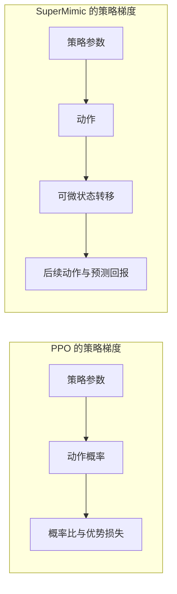
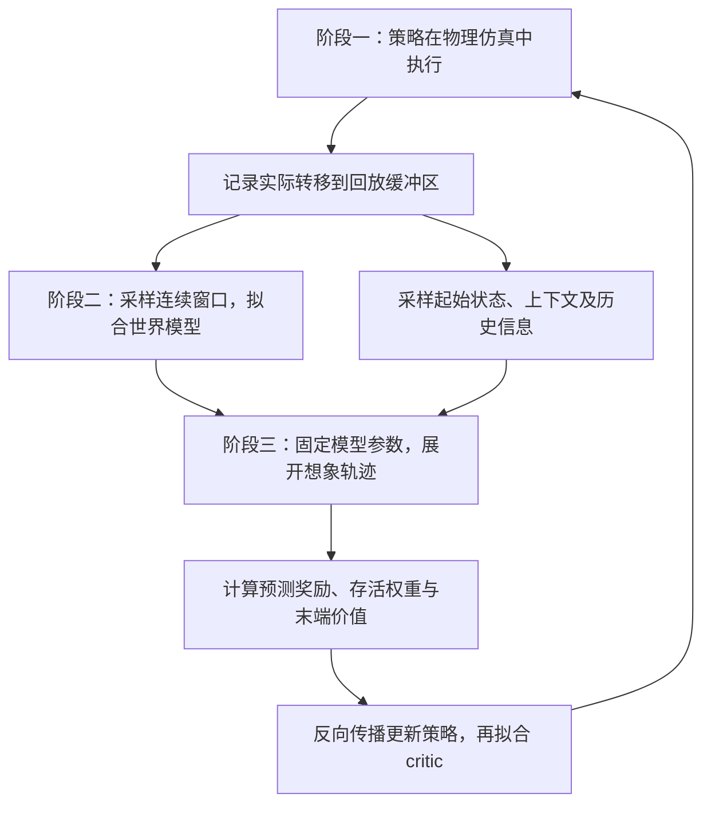

<!-- Copyright (c) 2026-2027 zh -->

# SuperMimic 阅读笔记：训练如何工作，PPO 在哪里被替换

本文从当前 Go2 速度跟踪任务出发，先解释 PPO 与 SuperMimic 的区别，再展开论文的模型、梯度、网络结构和实验依据。重点回答：**策略网络还在不在、仿真器还要不要、PPO 究竟在哪一层被替换，以及当前项目需要怎样理解这个变化。**

- 论文：*SuperMimic: Scaling Humanoid Whole-Body Control with One Differentiable World Model*，Qiayuan Liao 等，arXiv:2610.28480v1。
- 原文：[英文 PDF](SuperMimic_2610.28480v1.pdf)；辅助材料：[中文 PDF](SuperMimic_2610.28480v1_zh.pdf)。本文的章节、公式和页码均以英文原文为准。
- 阅读与源码核查日期：2026-10-26（Asia/Shanghai）。当前环境依赖元数据为 MjLab 1.6.0、RSL-RL 5.4.2。
- 范围：论文讲解和源码静态核对；未新增算法、未启动训练，也没有在本项目复现论文效果。

建议第一次先读第 1～5 节，弄懂替换关系；再读第 6～10 节理解论文细节。第 11～14 节用于判断实验结论、定位项目代码和规划验证。

阅读导航：

- [PPO 的替换位置](#1-最先回答ppo-在哪里被替换)
- [环境、策略、PPO、世界模型与 critic](#2-先分清五个角色)
- [SuperMimic 每轮训练](#4-supermimic-每轮训练具体做什么)
- [策略怎样穿过模型训练](#7-策略怎样穿过模型训练)
- [当前 Go2 的真实代码调用链](#12-对应当前-go2-项目的代码位置)
- [验证路线与未公开细节](#14-最小验证路线与论文未公开细节)

全文使用以下依据标记，详细来源见第 16 节：

| 标记 | 含义 | 结论边界 |
| --- | --- | --- |
| 论文依据 | 原文明确给出的机制、参数或作者报告的实验 | 不代表本项目已经复现 |
| 本项目事实（静态核查） | 当前源码、配置及已安装依赖中的实际定义 | 不代表本次完成运行或训练验证 |
| 参考项目依据 | 已阅读的上游或独立复现代码 | 只能说明对应版本的实现选择 |
| 推断／待验证假设 | 对设计作用的解释或 Go2 迁移建议 | 需要按文中方法验证 |
| 教学示例 | 为说明原理构造的简化系统或数值 | 不作为机器人实验结果 |

## 1. 最先回答：PPO 在哪里被替换

**SuperMimic 替换的是策略训练算法：将 PPO 的概率比与优势更新，改为通过可微世界模型中的短轨迹反向传播来更新策略。与此同时，训练流程增加世界模型拟合和想象轨迹。**（论文依据：P1，§3.1～3.3，第 4～6 页。）

机器人、动作接口、奖励目标和策略网络这些概念仍然存在，发生变化的是训练它们的具体组织方式。

| 环节 | 当前 Go2 PPO 路线 | SuperMimic 路线 |
| --- | --- | --- |
| 环境执行 | 在物理仿真中执行动作 | 仍在物理仿真中执行动作，收集模型训练数据 |
| 策略网络 | 根据观测输出动作分布，训练采样动作 | 根据观测和目标输出确定性动作；采集阶段额外加动作噪声 |
| 动力学预测 | PPO 不显式学习动力学 | 学习世界模型，预测动作造成的状态变化 |
| 策略更新 | 用采样优势和新旧动作概率之比构造 PPO 目标 | 用预测奖励、存活权重和末端价值构造目标，经模型反传 |
| critic | 估计后续收益，支持 GAE 和价值拟合 | 估计短轨迹之后的收益，在想象轨迹上拟合 |
| 存储 | 本轮 on-policy rollout，更新后清空 | 持续保留仿真转移的 replay buffer，另生成想象轨迹 |
| 部署执行 | 观测输入策略，输出关节动作 | 同样执行训练好的策略；论文部署不要求逐步调用世界模型规划 |

### 1.1 在当前项目中的准确位置

**本项目事实（静态核查）**：当前 Go2 任务使用的是 MjLab／RSL-RL 训练调用链：

```text
scripts/train.py：run_train()
  → 从任务注册表获取 VelocityOnPolicyRunner
  → MjlabOnPolicyRunner
  → rsl_rl.runners.OnPolicyRunner.learn()
      → self.alg.act(obs)
      → env.step(actions)
      → self.alg.process_env_step(...)
      → self.alg.compute_returns(obs)
      → self.alg.update()
          → rsl_rl.algorithms.PPO.update()
```

任务注册见 [config/__init__.py](../src/tasks/locomotion/go2_ppo/config/__init__.py)，项目运行器见 [rl/runner.py](../src/tasks/locomotion/go2_ppo/rl/runner.py)。`VelocityOnPolicyRunner` 扩展了保存和导出，没有重写训练循环。

如果接入论文方法，需要将上述“仿真采样 → GAE → PPO 更新”循环调整为“仿真采集 → 拟合世界模型 → 想象轨迹 → 策略和 critic 更新”。因此，**算法层的直接替换点是 `PPO.update()`，工程上还需要配套的新训练循环和数据接口。**

此前聊天中用 [agents/base/algorithms/ppo.py](../agents/base/algorithms/ppo.py) 说明过 PPO 的概率比损失。这个文件确实存在，可以用于理解原理；但当前注册的 Go2 任务并未走这份本地 PPO。查看实际执行路径时，应以上面的 MjLab／RSL-RL 调用链为准。

### 1.2 为什么当前打开的环境配置文件不能完成替换

[go_ppo_env_cfg.py](../src/tasks/locomotion/go2_ppo/go_ppo_env_cfg.py) 定义观测、动作、奖励、命令、随机化和终止条件，负责回答“机器人在什么任务里学习”。

[config/rl_cfg.py](../src/tasks/locomotion/go2_ppo/config/rl_cfg.py) 装配 actor、critic 和 PPO 参数，负责选择当前算法配置。

训练器负责回答“拿到这些数据后，怎样更新模型参数”。增加世界模型后，还需要状态采集、回放采样、可微奖励和想象训练等能力。单独调整环境中的奖励权重或 PPO 超参数，无法得到论文的方法。

## 2. 先分清五个角色

### 2.1 环境：执行动作并产生结果

环境包含机器人模型、执行器、地面、接触、传感器和任务规则。

```text
当前状态 + 动作 → 物理仿真器 → 下一状态、观测、奖励、终止标志
```

本文提到的“仿真数据”，指物理仿真实际执行得到的结果；“预测数据”指世界模型计算出的结果，二者需要分开。

### 2.2 策略网络：决定现在做什么

策略网络也称 actor，用参数 θ 表示：

$$
a_t=\pi_\theta(o_t,g_t)
$$

`o_t` 是机器人可获取的观测，`g_t` 是目标。当前 Go2 把速度命令作为观测项之一；上式将目标单独写出来，是为了对应论文符号。

对 Go2，动作是 12 维关节控制输入；论文的 G1 是 29 维。动作再经过缩放、默认关节姿态偏置和执行器，影响身体运动。

### 2.3 PPO：修改策略参数的一种算法

PPO 训练策略网络。它使用执行得到的奖励、价值估计和动作概率，构造更新目标。

所以“替换 PPO”可以保留“观测输入网络、网络输出动作”这套执行结构，但会改变训练数据如何使用、损失如何计算以及梯度如何产生。

### 2.4 世界模型：预测执行动作会发生什么

世界模型中的动力学部分用参数 ω 表示：

$$
\hat s_{t+1}=f_\omega(\hat s_t,a_t,\xi)
$$

它学习“这个状态下施加这个动作，在这组物理参数下，下一状态是什么”。帽子 `^` 表示预测量。

它没有直接告诉机器人应该走路、跳跃还是翻滚；这些意图由目标和奖励指定。

### 2.5 critic：估计当前处境以后的收益

critic，也称价值网络，用参数 ψ 表示：

$$
V_\psi(s_t,g_t,\xi)
$$

它判断“从现在继续执行策略，未来大概还能得到多少收益”。PPO 和 SuperMimic 都有 critic，但使用和训练方式存在差异。

### 2.6 状态与观测为什么分开

仿真状态 `s` 描述系统内部情况；策略观测 `o` 只包含允许提供给策略的信息。仿真能知道的信息，部署时未必能直接测到。

论文让世界模型使用仿真状态和已知上下文，让策略使用带噪声的本体观测历史与目标。**原文没有完整列出世界模型状态向量 `s` 的所有分量及坐标系，不能把任何社区实现的具体状态维度当成论文明确规定。**（论文依据：P1，§3.1～3.2、附录 A。）

## 3. 当前 PPO 怎样学习“以 1 m/s 前进”

以下例子只帮助理解训练信号，不代表已测得的 Go2 数据。

假设命令要求向前速度 1 m/s，当前速度是 0.6 m/s。策略采样出一组 12 维关节动作，仿真器执行后，得到新的速度、姿态和接触状态。奖励函数判断速度跟踪、身体稳定、动作变化等表现。

PPO 再用 critic 和 GAE 估计优势 `A_t`。优势衡量这次行为相对基准表现好多少：正优势鼓励提高相应动作的概率，负优势鼓励降低概率，实际幅度还受到裁剪目标等因素影响。

### 3.1 PPO 的策略目标

新旧策略对同一动作给出的概率之比为：

$$
\rho_t(\theta)=\frac{\pi_\theta(a_t\mid o_t)}{\pi_{\mathrm{old}}(a_t\mid o_t)}
$$

常见 PPO 裁剪目标是：

$$
L_{\mathrm{clip}}(\theta)=
\mathbb E\left[\min\left(\rho_t A_t,
\operatorname{clip}(\rho_t,1-\varepsilon,1+\varepsilon)A_t\right)\right]
$$

当前 RSL-RL 使用最小化负目标的等价形式。已安装版本 `rsl_rl/algorithms/ppo.py` 的 `PPO.update()` 中，关键计算位于第 262 行附近：

```python
# 当前实现的核心逻辑摘录；省略类型注释和其他损失。
ratio = torch.exp(actions_log_prob - torch.squeeze(batch.old_actions_log_prob))
surrogate = -torch.squeeze(batch.advantages) * ratio
surrogate_clipped = -torch.squeeze(batch.advantages) * torch.clamp(
    ratio, 1.0 - self.clip_param, 1.0 + self.clip_param
)
surrogate_loss = torch.max(surrogate, surrogate_clipped).mean()
```

后续合并价值损失和熵项，再调用 `loss.backward()` 与优化器更新。（本项目事实：L5，RSL-RL 5.4.2 本地源码。）

### 3.2 PPO 也在反向传播，区别在于反传经过哪里

**两种方法都使用神经网络反向传播。区别是，PPO 的策略损失没有经过物理状态转移的计算图。**

PPO 的梯度主要沿着“策略参数 → 动作概率 → PPO 损失”计算。采集到的状态、动作、奖励和优势在策略更新时作为数据使用。

SuperMimic 的梯度沿着“策略参数 → 动作 → 预测下一状态 → 后续策略动作 → 预测回报”计算。它额外利用了模型对动作和状态的导数。



图中的箭头表示前向计算依赖；反向传播沿相反方向计算梯度。PPO 的优势同样包含未来收益信息，这张图不表示 PPO 只关心当前一步。

## 4. SuperMimic 每轮训练具体做什么

论文图 2 与算法 A.1 将训练分为三个阶段。它们在一个循环中持续交替进行。（论文依据：P1，第 4 页、第 15 页。）



### 4.1 阶段一：在物理仿真中采集数据

策略产生动作，采集阶段加入噪声：

$$
a_t^{\mathrm{exec}}=\pi_\theta(o_t,g_t)+\epsilon_t,
\qquad\epsilon_t\sim\mathcal N(0,0.1^2 I)
$$

仿真器执行 `a_exec`，回放缓冲区保存实际转移。拟合动力学时，输入动作必须与仿真实际执行的动作对应。

**世界模型的监督来自仿真转移。参考动作库提供目标和初始化依据，但参考姿态序列本身不等同于策略执行产生的动力学数据。**

仿真上下文、终止标签、干净观测以及奖励监督所需的目标信息，也必须在数据接口中有明确来源。需要怎样存储这些信息，取决于预测头的实现。

### 4.2 阶段二：用记录的数据拟合世界模型

从缓冲区中取连续 8 步窗口。模型从记录的初始状态出发，使用记录的动作连续预测，比较预测结果与实际结果。

这一阶段更新的是世界模型参数 ω，目的是降低预测误差。

### 4.3 阶段三：在世界模型中改善策略

从缓冲区采样起点，使用当前策略生成新动作，让模型向前推演 32 步。每一步都根据预测观测重新调用策略，形成闭环。

这一阶段使用的是当前策略新生成的动作，不是将前面记录的整段动作再播放一次。记录动作服务于模型拟合；想象动作服务于策略改进。

根据预测奖励与末端价值构造目标，通过整段轨迹反向传播更新 θ，再使用想象轨迹训练 critic。

### 4.4 为什么模型训练和策略训练要交替

论文使用当前策略持续收集数据，使世界模型跟进策略探索到的新状态和动作。模型只在单次策略更新内固定，之后仍继续训练。（论文依据：P1，§3.1、算法 A.1；官方说明 P2。）

旧策略采集的转移仍可用于拟合动力学，因为机器人在相同条件下的物理规律不随策略版本变化。不过，当资产、执行器或随机化语义改变时，旧数据是否仍匹配需要重新核对；数据覆盖也不等于任意分布上的准确性。（后两项为迁移分析。）

## 5. 一个数值例子：模型怎样提供改进方向

本节是教学示例，不是 Go2 动力学，也不是论文的实验。

假设一个非常简单的速度模型为：

$$
\hat v_{t+1}=v_t+0.1a_t
$$

目标速度为 1，奖励为：

$$
r=-(\hat v_{t+1}-1)^2
$$

当 `v_t=0.6`、`a_t=0.2` 时：

$$
\hat v_{t+1}=0.62,\qquad r=-0.1444
$$

通过链式法则：

$$
\frac{\partial r}{\partial a_t}
=-2(\hat v_{t+1}-1)\times0.1=0.076
$$

导数为正，说明在这个模型附近，稍微增大动作预计能提高奖励。再乘上策略输出对参数的导数，就能修改策略参数：

$$
\frac{\partial r}{\partial\theta}
=\frac{\partial r}{\partial a_t}
\frac{\partial a_t}{\partial\theta}
$$

真实机器人是多维、非线性且接触频繁的系统，无法用上面这个线性模型描述；但“回报 → 状态 → 动作 → 策略参数”的链式求导原理相同。

这也说明模型质量为什么关键：如果模型错误地判断某个动作能加速，策略就可能沿错误方向学习。**能求出梯度，与梯度能改善物理仿真中的表现，是两个需要分别检查的问题。**

## 6. 世界模型如何设计和训练

### 6.1 动力学与任务目标分开

论文的动力学输入是状态、动作、上下文：

$$
\hat s_{t+1}=f_\omega(\hat s_t,a_t,\xi)
$$

奖励和终止还依赖目标。相同身体状态和动作，不会因为目标是“跳跃”还是“跳舞”而改变其物理规律，但在不同目标下，奖励可能不同。

这是共享模型能够服务多种动作和目标接口的结构基础。其实际扩展效果仍以论文已测试的机器人与状态分布为限。（论文依据：P1，§3.2、附录 B。）

### 6.2 为什么输入仿真上下文 ξ

如果不提供摩擦参数，模型可能在相似状态和动作下看到不同滑动结果。论文将已知的域随机化参数作为条件输入，使确定性模型能够区分这些条件。

附录 A、表 A.3 给出的随机化包括：

| 参数 | 采样范围 |
| --- | --- |
| 摩擦系数 | 0.3～1.2 |
| 关节标定偏移 | 每关节 ±0.01 rad |
| 躯干质心 x 偏移 | ±0.025 m |
| 躯干质心 y、z 偏移 | 各 ±0.05 m |

这些参数提供给训练端的模型。论文部署策略的输入仍是本体观测历史与目标，没有要求策略直接获取真实摩擦或真实质心偏移。

### 6.3 为什么传感器噪声放在模型外

论文将观测分为：

$$
o_t=\bar o_t+\eta_t
$$

模型预测干净观测，想象训练再加入已知分布的传感器噪声。这样，策略能在含噪观测下训练，而模型不用将每一次随机噪声实现都作为必须预测的物理变化。（论文依据：P1，§3.1～3.2。）

需要区别两类噪声：采集阶段的动作噪声 ε 扩充模型训练数据；观测噪声 η 模拟策略收到的测量扰动。论文想象训练没有额外加入采集用的动作噪声。

### 6.4 为什么连续拟合 8 步

模型从日志中的 `s_0` 出发：

$$
\hat s_0=s_0,\qquad
\hat s_{j+1}=f_\omega(\hat s_j,a_j^{\mathrm{logged}},\xi)
$$

每一步都使用模型预测的状态作为下一步输入，动作使用日志动作。这样训练会暴露误差累积，区别于每一步都喂入真实状态的单步拟合。

论文公式 1 的损失为：

$$
\mathcal L_{\mathrm{WM}}=
\mathbb E_{\mathcal B}\sum_{j=1}^{8}
\left[
\|\hat s_j-s_j\|^2
+(\hat r_j-r_j)^2
+\|\hat{\bar o}_j-\bar o_j\|^2
+\operatorname{BCE}(\hat d_j,d_j)
\right]
$$

其中奖励、观测、终止输出可以学习或解析计算，解析输出不设置对应学习损失。原文没有完整列出各输出的具体实现分工。

8 步拟合覆盖约 0.16 秒，策略想象覆盖约 0.64 秒；这是两个不同用途的长度。短窗口拟合改善自回归误差，不构成长时间稳定性或梯度正确性的保证。

### 6.5 模型状态需要满足什么条件

这是 Go2 迁移时的推断与接口要求：模型输入应包含预测转移所需的信息。若执行器依赖历史动作、延迟队列或内部状态，只提供当前位置与速度可能不够。

奖励还可能依赖上一动作、前一时刻关节速度、步态相位或接触计时。这些信息可以成为扩展状态或想象过程中的辅助记忆，但必须明确谁更新、何时重置。

原论文没有给出足以直接照抄的完整状态协议。社区采用的残差、积分和坐标规范化方案应作为候选实现独立验证，不能视为作者已公开的细节。

## 7. 策略怎样穿过模型训练

### 7.1 32 步是连续的闭环预测

想象轨迹中的每一步都遵循：

$$
a_t=\pi_\theta(\hat{\bar o}_t+\eta_t,g_t),\qquad
\hat s_{t+1}=f_\omega(\hat s_t,a_t,\xi)
$$

当前动作影响下一状态，下一状态影响后续观测、后续动作和最终回报。因此，某一步的损失可以通过多步依赖影响更早的策略输出。这就是 BPTT，即沿时间展开后反向传播。

参考目标由动作数据或目标接口给出。世界模型预测机器人怎样运动，参考目标序列无需由动力学模型生成。

### 7.2 固定模型参数与切断梯度是两回事

策略更新时，世界模型参数 ω 固定，避免策略损失同时改变预测器；但必须保留：

$$
\frac{\partial f_\omega}{\partial a_t},
\qquad\frac{\partial f_\omega}{\partial\hat s_t}
$$

这两个导数负责把后续结果对动作和状态的敏感性传回策略。

把模型参数设为不参与优化，与在整个想象过程上使用 `torch.no_grad()` 的效果不同。后者会切断所需计算图。中间预测状态或策略动作随意 `detach()`，也会破坏跨时间的梯度路径。

初始状态可以从回放数据中分离出来；之后的连续预测需要保留计算图。critic 末端价值同样要保留对末端状态的导数，才能影响策略。（公式 2 的含义；具体梯度组织是实现时必须核对的内容。）

### 7.3 策略目标为什么包含存活权重和末端价值

论文公式 2 为：

$$
\hat J(\theta)=\mathbb E\left[
\sum_{t=0}^{H-1}\gamma^t\hat c_t\hat r_{t+1}
+\gamma^H\hat c_H V_\psi(\hat s_H,g_H,\xi)
\right],\qquad H=32
$$

可以按三部分理解：

| 部分 | 含义 |
| --- | --- |
| 预测奖励之和 | 未来 32 步内动作做得怎样 |
| 存活权重 ĉ | 如果已经接近失败，后续收益应相应降低 |
| 末端价值 V | 到第 32 步时，留下的状态是否有利于继续完成任务 |

策略通过梯度上升提高 J；使用损失最小化写法时，可以令 `actor_loss = -J.mean()`。

### 7.4 为什么终止概率需要可微

仿真器记录硬终止 `d∈{0,1}`，模型给出终止概率 `d̂∈[0,1]`。存活权重递推为：

$$
\hat c_0=1,\qquad
\hat c_{t+1}=\hat c_t(1-\hat d_{t+1})
$$

动作若提高预测失败概率，会降低后续收益，形成可供策略使用的梯度信号。（论文依据：P1，§3.1、公式 2。）

终止预测偏差也会影响策略：低估风险可能让策略追逐无法实现的预测收益；高估风险可能使行为过于保守。需要在物理仿真中检查，而不能只看模型内损失。（推断／待验证风险。）

## 8. critic 为什么保留，怎样训练

### 8.1 短轨迹之后仍然有后果

假设某个动作在前 0.64 秒内跟踪很好，但把机器人带到难以恢复的姿态。仅累计窗口内奖励可能难以区分这种行为。

critic 用末端状态估计后续收益，帮助策略考虑更远的后果。它也存在估计误差，因此“模型短期准确”不等于整体目标完全准确。（前者为公式 2 的设计解释，后者为估计误差分析。）

### 8.2 critic 使用想象轨迹的回报目标

论文公式 3 使用以下递推：

$$
\hat R_t=\hat r_{t+1}
+\gamma(1-\hat d_{t+1})
\left[(1-\lambda)V_{t+1}+\lambda\hat R_{t+1}\right]
$$

其中：

$$
V_t=V_\psi(\hat s_t,g_t,\xi),\qquad
\hat R_H=V_H,\qquad\lambda=0.95
$$

拟合目标为：

$$
\mathcal L_V=\mathbb E\sum_{t=0}^{H-1}(V_t-\hat R_t)^2
$$

目标在一次 rollout 后计算，并在本次 critic 拟合期间固定。这里用到 GAE／λ-return 思想，但策略更新已经不使用 PPO 的概率比目标。**出现 GAE 或 critic，不能据此判断算法仍然是 PPO。**（论文依据：P1，§3.3。）

### 8.3 与 SHAC 的联系及论文消融

SuperMimic 明确借鉴 SHAC 的短视界 actor–critic 思路，使用学习动力学替代其可微仿真，并采用软存活权重；论文的 critic 没有 EMA 目标网络。（论文依据：P1，第 6 页。）

参考项目 R1 的 `compute_actor_loss()` 将短轨迹奖励与末端价值合入 actor 损失，`actor_closure()` 再执行反向传播。这支持理解短轨迹与 critic 的组合，但 R1 使用可微仿真，与本文学习动力学的条件不同。

作者的消融报告：H=16 时，带 critic 的版本可以达到目标，无 critic 的版本未达到目标；H=32 达到目标最快。H=128 的时间和最终表现更差。静态姿态推扰实验中，带 critic 的策略能重新稳定，无 critic 的策略即使名义跟踪回报接近，恢复表现仍较差。（论文依据：P1，§4.3、图 4。）

## 9. 策略网络、动作接口和多目标接口

### 9.1 用目标编码器和共享解码器组织策略

论文使用：

$$
z=\operatorname{enc}_{\theta,i}(g),\qquad
a=\operatorname{dec}_\theta(z,o_{\mathrm{history}})
$$

目标编码器将“要做什么”压缩成 32 维、经过 tanh 限幅的潜变量；共享解码器结合观测历史输出动作。速度编码器还接收观测历史的特征。（论文依据：P1，附录 B、C。）

表 A.4 的隐藏层宽度如下：

| 模块 | 输入与输出 | 隐藏层宽度 |
| --- | --- | --- |
| 动力学 | 状态、动作、上下文 → 下一状态 | 2048、2048、2048 |
| 动作编码器 | 未来 10 帧参考 → z | 2048、1024、512、256 |
| 共享解码器 | z、最近 10 帧本体观测 → 动作 | 2048、1024、512、256 |
| 速度编码器 | 速度命令、历史特征 → z | 256、256 |
| 每接口 critic | 状态、目标、上下文 → 标量价值 | 256、128 |

该潜变量结构没有在本文中配套 VAE 的随机潜变量与 KL 目标，不能仅凭“编码器／解码器”名称将其理解成 VAE。

### 9.2 策略具体看到什么

G1 单帧本体观测为 93 维，策略使用最近 10 帧。（论文依据：P1，附录 A、表 A.1。）

| 项目 | 维度 | 均匀噪声范围 |
| --- | --- | --- |
| 相对默认姿态的关节位置 | 29 | ±0.01 rad |
| 关节速度 | 29 | ±0.5 rad/s |
| 基座角速度 | 3 | ±0.2 rad/s |
| 投影重力 | 3 | ±0.05 |
| 上一动作 | 29 | 无 |

10 帧历史和 10 帧未来参考，在 50 Hz 下分别覆盖约 0.2 秒。前瞻有助于提前准备动作，历史有助于利用过去信息；这两点是设计解释，论文没有单独证明所有历史分量各自的必要性。

### 9.3 动作怎样进入关节控制

动作映射为关节位置设定值：

$$
q^{sp}=\alpha a+q^0
$$

作者沿用 BeyondMimic 的较低 PD 增益，并将这种设定值解释为近似调节关节力矩的代理。（论文依据：P1，附录 A。）

当前 Go2 也有位置动作、默认偏置和缩放，但增益、限幅、机器人动力学不同。共享“位置动作接口”不能说明相同网络和训练参数就能直接工作。

### 9.4 速度接口怎样训练

作者让速度编码器与动作跟踪接口共同训练，共享动力学和解码器，各接口使用自己的 critic。速度 RL 接口使用速度任务奖励，而论文称作蒸馏的基线使用参考动作跟踪奖励、以参考动作读出的速度作为命令。（论文依据：P1，附录 B、G。）

速度任务回报的梯度穿过共享解码器，更新速度编码器；共享解码器权重仍由动作跟踪目标更新。参考命令样本上，另用权重 0.1 的 MSE 将速度潜变量拉向动作潜变量，动作潜变量作为固定目标。

这项“蒸馏基线”的具体定义应按论文理解，不能直接替换成普通的教师动作 MSE 行为克隆。速度 RL 也不是完全脱离动作先验从头训练整个控制器。

表 A.6 的速度任务项包括：

| 项目 | 形式或含义 | 权重 |
| --- | --- | --- |
| 平面速度 | exp(−‖v_xy−v_xy_cmd‖² / 0.5²) | 2.0 |
| 偏航率 | exp(−(ω_z−ω_z_cmd)² / 0.5) | 2.0 |
| 动作变化 | ‖a_t−a_(t−1)‖² | −0.3 |
| 关节限位 | 越界距离之和 | −2 |
| 躯干侧倾 | sin²(侧倾角) | −4 |
| 躯干滚转、俯仰角速度 | 两分量平方和 | −0.05 |

注意原文偏航率项的分母为 0.5，线速度项为 0.5²。平面速度使用航向系，偏航率使用世界系；各奖励项乘控制周期 0.02 秒。G1 速度接口的根部高度终止阈值为 0.35 m，这个阈值不适用于当前 Go2。

## 10. 奖励、数据与训练参数

### 10.1 主任务是动作跟踪

主实验要求机器人跟踪参考身体轨迹。奖励覆盖身体位置、朝向、线速度、角速度，以及根部位置和朝向；另有动作平滑和关节限位项。（论文依据：P1，表 A.2。）

| 跟踪项 | 权重 |
| --- | --- |
| 身体位置、朝向、线速度、角速度 | 各 1.0 |
| 根部位置、根部朝向 | 各 0.5 |
| 动作变化平方和 | −0.1 |
| 关节限位 | −2 |

论文删除 BeyondMimic 的自碰撞惩罚，并将关节限位权重从 −10 改为 −2。作者对删除自碰撞项的解释是：随机策略可能借助身体互相挤压抑制动作噪声，提高速度跟踪奖励，而其想象策略动作是确定性的。该解释针对特定任务与噪声设置，不能推出其他机器人任务都无需此约束。

主任务在根部高度偏差超过 0.25 m，或倾斜误差超过 0.8 时终止。倾斜误差比较参考与机器人根部坐标系中重力方向的 z 分量；论文取消了末端偏差终止。这个终止规则也与 Go2 现有速度任务不同。

### 10.2 数据清理控制了任务范围

作者将 142,220 段 G1 重定向 BONES-SEED 动作筛到 129,514 段。先按名称排除需要楼梯、椅子、箱体等支撑的动作，再用运动学检查排除高处支撑、穿地、静止悬空等问题。筛选后的动作总长为 264.56 小时。（论文依据：P1，附录 E。）

可行性阈值针对 G1、50 Hz 和平地条件设定。清理后的训练范围与“能处理任意物体交互、任意地形”有明显区别。

### 10.3 回报驱动的重置采样

动作时间轴按 1 秒分段，根据策略从各片段获得的折扣回报组织重置：

- 50% 均匀采样，维持广泛覆盖。
- 40% 按当前低回报的 softmax 权重采样，增加困难片段练习。
- 10% 按历史 softmax 权重采样，保留曾经困难片段的练习机会。

该机制针对动作库中的起点采样，与当前 Go2 按速度命令或地形等级推进的课程并不等价。（论文依据：P1，附录 D.1；与 Go2 的对应为静态核查。）

### 10.4 表 A.5 的主要超参数

| 项目 | 原文配置 |
| --- | --- |
| 模型拟合窗口 k | 8 |
| 模型训练批量 | 每次更新 10 批，每批 2048 个窗口 |
| 模型优化器 | Adam |
| 单 GPU 学习率 | 2×10⁻⁴，策略与 critic 相同 |
| 双 GPU 学习率 | √2×2×10⁻⁴ |
| 模型梯度裁剪 | 全局范数 1.0 |
| 想象长度 H | 32 |
| 策略想象批量 | 每次更新 4096 条轨迹 |
| 策略优化器 | Adam，β=(0.9, 0.95) |
| 策略梯度裁剪 | 先全局范数 1.0，再逐元素 0.1 |
| 折扣 γ | 0.99 |
| critic λ | 0.95 |
| critic 拟合 | 每次更新 5 个 epoch，每个 epoch 4 个小批量 |
| critic 梯度裁剪 | 全局范数 1.0 |
| 仿真规模 | 每 GPU 4096 个环境 |
| 采集动作噪声 | 每维 N(0, 0.1²) |
| 回放容量 | 每环境 1000 步，4096 环境名义上约 409.6 万条转移 |
| Update-to-data ratio | 0.4 |
| 策略／世界模型更新次数比 | 1 |
| 学习率调度 | 25 万迭代内余弦降至初始值的 0.03 倍，之后保持 |
| 主训练迭代长度 | 32 万 |
| 多 GPU | 数据并行，梯度平均 |

表中的 UTD 与“迭代”的精确调度关系，以及 10 批窗口如何组织，原文没有写到足以直接还原代码的程度。不能由 UTD=0.4 擅自推出每次循环固定采集多少步。

“3 小时超过 SONIC”是达到比较指标的时间点，不是所有实验统一停止时间。速度接口实验另有 10 万迭代的训练设置。（论文依据：P1，§4.1、附录 D、G。）

## 11. 实验结果支持什么，尚不支持什么

### 11.1 效率提升的三组证据

| 作者报告 | 对应依据 | 可以支持的判断 |
| --- | --- | --- |
| 数据从 1 小时扩到 264 小时，8 步归一化状态误差保持在 0.007～0.011 | 图 3，§4.2 | 在该机器人和策略分布下，一个模型覆盖了更大的动作库 |
| 实际训练批量范围内，模型 rollout 吞吐比 MuJoCo Warp 高 10 倍以上 | 图 5(a) | 模型产生转移的成本较低 |
| 达到 PPO-WM 最佳训练回报约少用 64 倍想象步数 | 图 5(b) | 在该实验中，解析梯度的收益超出单纯加快 rollout |

8 步误差经过名义误差归一化，并在策略 rollout 上在线测量。0.007 不能读作 0.007 m，也不能说明任意状态、动作和接触下都有相同准确性。模型 rollout 的吞吐加速也不能直接当作完整训练的提速倍数。

### 11.2 与 PPO-Sim 的受控对照

LAFAN1 实验使用 40 个片段、2.45 小时数据。PPO-Sim 对齐动作、观测、奖励、终止、随机化、actor／critic 网络规模和评测协议，使用 BeyondMimic PPO 超参数。SuperMimic 单卡 1.2 小时达到评测回报 0.82，PPO-Sim 在论文给出的 18 小时预算内未达到该值。（论文依据：P1，§4.1、图 4(a)。）

这支持论文设置下的整体效率差异，但不能推出“任意机器人、任意 PPO 调参方案都能得到同样倍数”。PPO-WM 消融还使用了特定走、跑、冲刺动作子集，其结论范围应单独保留。

### 11.3 与 SONIC 的算力比较

作者比较 SuperMimic 的 1 张 H100、3 小时，与 SONIC 报告的 128 张 L40、168 小时。按数量相乘约为 3 对 21,504 GPU 小时，论文保守表述为减少超过 1000 倍。硬件不同，数据量也不同：SuperMimic 为 264.56 小时，SONIC 为 611 小时。（论文依据：P1，§4.1 的计算口径说明。）

因此，这是跨系统的训练成本比较，不能解释成在完全相同设备、数据和实现条件下测得的算法独立提速。3 小时包括采集、模型拟合和策略更新，不包括训练结束后的检查点评测。

### 11.4 “零失败”的准确含义

作者报告：在 129,514 段动作上，SONIC 已发布检查点失败 179 段，SuperMimic 单卡训练 3 小时失败 25 段，双卡训练 9.8 小时失败 0 段。（论文依据：P1，表 A.8。）

附录 F 明确限定：

- 基准动作是双方训练集中的动作，测的是覆盖率，不是未见动作泛化。
- 每段从首帧播放一次。
- 摩擦固定为 1.0，无观测噪声、无域随机化，物理过程确定。
- 采用 SuperMimic 的训练终止规则判断失败。
- 各策略使用自己的执行器增益、动作缩放和观测构造方式。

零失败不等于完美逐帧跟踪，也不等于随机化条件、真机重复试验中的零失败。

### 11.5 真机与速度接口结论

论文展示同一策略在 Unitree G1 上执行跳跃、侧滚、90° 翻转和原地 360° 翻转，无逐动作调参；文中没有提供足以推导长期可靠性的重复试验统计。（论文依据：P1，§4.4、图 6。）

速度接口在 672 个阶跃命令中，RL 编码器有 650 个命令误差更低，蒸馏编码器有 15 个；两者中位相对稳态误差为 0.16 与 0.49。每种策略只有一个训练种子，属于作者明确称为初步研究的结果。（论文依据：P1，§4.5、附录 G。）

原论文限制还包括：世界模型仅用仿真数据训练；仅覆盖平地；速度奖励没有更新共享解码器，联合训练的必要性尚未验证。（论文依据：P1，§6。）

## 12. 对应当前 Go2 项目的代码位置

本节均为本次静态核查。安装目录属于当前环境的依赖源码定位，不是建议修改依赖文件。

| 职责 | 当前位置与定位 | 与论文替换的关系 |
| --- | --- | --- |
| 入口装配 | [scripts/train.py](../scripts/train.py)，`run_train()`，第 80 行附近 | 创建环境、读取任务 runner，调用 learn |
| Go2 任务注册 | [config/__init__.py](../src/tasks/locomotion/go2_ppo/config/__init__.py)，两个 `register_mjlab_task()` | 当前选择 VelocityOnPolicyRunner |
| 项目 runner | [rl/runner.py](../src/tasks/locomotion/go2_ppo/rl/runner.py)，`VelocityOnPolicyRunner` | 当前主要扩展保存与导出 |
| 框架 runner | [MjLab runner](../.venv/lib/python3.11/site-packages/mjlab/rl/runner.py)，`MjlabOnPolicyRunner` | 继承 RSL-RL，增加配置、持久化与导出支持 |
| 实际训练循环 | [RSL-RL runner](../.venv/lib/python3.11/site-packages/rsl_rl/runners/on_policy_runner.py)，`learn()` 第 56 行；第 108 行调用 alg.update | 需引入采集、模型拟合、想象训练的调度 |
| 实际 PPO 更新 | [RSL-RL PPO](../.venv/lib/python3.11/site-packages/rsl_rl/algorithms/ppo.py)，`update()` 第 190 行；第 262 行附近构造概率比损失 | 核心算法替换位置 |
| 本地通用 PPO | [agents/base/algorithms/ppo.py](../agents/base/algorithms/ppo.py)，`update()` 第 136 行 | 可供原理对照，当前 Go2 注册路线不使用它 |
| 环境任务 | [go_ppo_env_cfg.py](../src/tasks/locomotion/go2_ppo/go_ppo_env_cfg.py)，`make_velocity_env_cfg()` | 保持任务职责，后续需提供模型数据接口 |
| 机器人参数 | [go2_config.py](../src/config/go2/go2_config.py)，`Go2Cfg` | 控制、噪声、延迟、随机化等模型条件的来源 |
| PPO 配置装配 | [config/rl_cfg.py](../src/tasks/locomotion/go2_ppo/config/rl_cfg.py)，`unitree_go2_ppo_runner_cfg()` | 当前明确构造 RslRlPpoAlgorithmCfg |

本地安装源码的准确行号随依赖更新可能变化，复查时优先按类名和函数名定位。当前包版本以 `pyproject.toml`、锁文件和安装元数据交叉核对。

### 12.1 已具备的相近条件

当前 Go2 使用位置动作，12 维输入，包含默认姿态偏置与分关节缩放。仿真步长为 0.005 秒，控制降采样为 4，控制周期为 0.02 秒，与论文一致。项目同时有平地与粗糙地形配置。（本项目事实：L2、L3。）

这些条件有利于复用仿真采集与控制接口，但不保证模型训练、想象奖励和策略更新自动成立。

### 12.2 随机动作延迟需要单独建模

`Go2Cfg.control` 设置延迟参数，`go2_constants.py` 将它们接入执行器，包括 `delay_min_lag=0`、`delay_max_lag=4`、保持概率与更新周期。（本项目事实：L2、L3。）

推断：当动作执行取决于队列时，只用身体状态和当前动作可能无法唯一预测下一步。需要核对执行器的更新时机、队列内容、当前延迟和新随机采样的语义。时变随机延迟也不能直接当成每回合固定的 ξ。

最小验证：固定身体状态与当前动作，改变历史动作或延迟状态，观察下一步是否改变；用相同物理初态和相同延迟状态做重复转移检查。由此确定模型接口需要包含哪些信息。

### 12.3 外力推扰是额外的随机源

当前 `push_robot` 事件通过 `push_by_setting_velocity` 周期性改变根部速度。原论文没有保留这种未建模推扰。（本项目事实：L3；论文依据：P1，附录 A。）

推断：若模型没有获得推扰信息，相同输入可能对应有推扰和无推扰两种结果。候选处理包括显式条件化已知扰动、标记并分开处理跨扰动转移，或先在无推扰配置中验证方法。选择哪一种应由目标任务决定，不能把论文的取舍直接当成本项目最终方案。

最小验证：比较受扰与未受扰窗口的预测误差，并在同等评测条件下检查恢复表现。

### 12.4 接触奖励需要有可用的梯度路径

当前 `feet_gait()` 用接触计时和布尔相等判断计算步态匹配，`soft_landing()` 使用首次触地事件及接触力；critic 观测也包含足端接触信息。（本项目事实：L3、L4。）

推断：将相同代码放进想象循环，不会自动获得模型对这些物理量的预测，也不会使布尔接触切换产生有用导数。直接读取仿真传感器缓存，更无法反传到想象动作。

需要选择可微计算、连续近似或学习预测头，并保持物理仿真中的原任务评测。最小验证是检查动作到预测奖励是否存在有限、非恒零的梯度，再验证建议调整能否改善物理仿真回报。接触切换附近应单独统计。

### 12.5 观测、任务目标和坐标系也有差异

当前 Go2 actor 默认为一帧、47 维，含速度命令和显式步态相位；G1 论文使用十帧本体历史与独立目标编码。当前 Go2 的线速度奖励还惩罚垂直速度，使用机体局部速度；论文速度接口使用航向系平面速度。（本项目事实：L2～L4；论文依据：P1，附录 A、G。）

增加历史是否改善速度估计、延迟适应或动力学推断，是待验证假设。最小方法是保持任务和预算一致，对比单帧与多帧；需要明确坐标变换、动作顺序和历史更新，而不是只改观测维度。

如果目标是当前 Go2 速度控制，可以先直接训练速度条件策略，验证学习动力学与 BPTT；若目标是复现论文完整的多动作跟踪和共享潜变量接口，还需要动作库与目标编码器。这是两个不同实验范围。

### 12.6 后续实现的职责边界

若未来决定实施，通用动力学模型、回放、想象 rollout 和优化器应归于 `agents/` 的独立算法模块；Go2 的状态采集、奖励、观测和终止留在任务模块；参数归 `src/config/`；脚本负责装配和启动。

当前文档不确定新模块的最终接口，也没有新增这些能力。正式实现应按项目工作流先形成对应设计，并保留现有 PPO 路线作为对照，避免直接改动 `.venv` 中的依赖源码。

## 13. 简化伪代码：把三种训练分开看

以下均为教学伪代码，函数名用于表达职责，未对应已实现接口，不可直接运行。日志、超时、回合末尾、批量掩码、历史更新等工程细节未展开。

### 13.1 当前 PPO 的结构

```text
重复每轮训练：
    在不记录仿真梯度的条件下：
        用当前随机策略采集一段仿真轨迹
        保存观测、动作、奖励、终止、价值和旧动作概率
        计算 GAE、回报目标与优势

    对这批数据执行若干轮小批量更新：
        重新计算动作概率和状态价值
        计算 PPO 裁剪损失、价值损失、熵项
        反向传播并更新策略和 critic

    清空本轮 rollout
```

### 13.2 SuperMimic 的外层循环

```text
重复每轮训练：
    阶段一：在物理仿真中执行策略加采集噪声
        记录实际转移和仿真上下文到回放缓冲区

    阶段二：训练世界模型
        采样 8 步连续窗口
        从记录初态开始，使用记录动作自回归预测
        计算预测与日志之间的监督损失
        更新世界模型参数

    阶段三：训练策略和 critic
        采样起始状态、观测历史及上下文
        固定世界模型参数，保留其输入导数
        由当前策略闭环展开 32 步
        保存本次 rollout 的 critic 拟合数据与固定目标
        最大化预测奖励与末端价值，更新策略
        使用分离后的想象样本与固定回报目标拟合 critic
```

### 13.3 单次策略更新的梯度结构

```text
固定世界模型和 critic 的参数，不更新它们
从回放数据取得独立的初始状态与历史
累计回报 = 0
存活权重 = 1

对 t = 0 ... 31：
    干净观测 = 从当前预测状态计算或预测观测
    动作 = 策略(历史中的含噪观测, 当前目标)
    下一预测状态 = 世界模型(当前预测状态, 动作, 上下文)
    奖励 = 对应当前转移和目标的可微奖励
    终止概率 = 下一预测状态与目标对应的终止概率

    累计回报 += γ^t × 存活权重 × 奖励
    存活权重 *= 1 − 终止概率
    更新预测状态和观测历史，保留计算图

累计回报 += γ^32 × 存活权重 × critic(末端状态, 末端目标, 上下文)
策略损失 = −批量平均(累计回报)
对策略损失反向传播
裁剪策略梯度，更新策略参数
恢复后续拟合需要的模型与 critic 参数梯度设置
```

该伪代码只展示公式 2 的策略梯度，critic 的监督训练应在独立的拟合阶段进行。奖励与终止要对应正确的转移索引；时间截断、真实失败、动作片段结束以及自动重置不能混成同一种标签。这些是落地时需要明确的边界条件。

## 14. 最小验证路线与论文未公开细节

### 14.1 先验证接口一致性

将同一组状态输入仿真与可微计算，对拍观测、坐标变换、动作缩放、正向运动学和可解析奖励。覆盖默认姿态、转向、非零速度与动作边界。失败会使模型误差和策略损失失去一致含义。

### 14.2 再验证模型预测

分开检查 1 步、8 步和 32 步误差，使用留出的仿真窗口；按站立、运动、落脚、离地、失衡分组。检查连续窗口没有跨自动重置，历史、上下文和终止前状态没有错位。

原论文误差归一化细节未完整公开，因此本项目需要定义可解释的物理量误差和归一化口径，不能只追求同样的 0.007 数字。

### 14.3 检查模型建议的动作方向

固定初始状态、上下文和随机源，在模型中计算小幅动作或策略参数调整，再从相同起点到物理仿真中比较实际回报。

由于接触不光滑，不应只检查一个状态的一次极小差分。应在多组样本和扰动尺度下统计模型与仿真回报变化的方向一致性、排序关系，以及真实收益是否提高；接触切换样本单独分析。

这是针对模型梯度可靠性的最小验证建议，并非论文已经给出的保证。

### 14.4 最后比较完整训练

固定机器人、任务、观测、动作、奖励、网络规模、种子和资源预算，比较：

- PPO-Sim：物理仿真中采样，PPO 更新。
- PPO-WM：模型中采样，PPO 更新，用于区分 rollout 加速的作用。
- BPTT-WM：通过可微模型反向传播，用于检查梯度更新的价值。

评价物理仿真中的回报、速度误差、跌倒、动作平滑和总训练耗时；分别计入采集、模型拟合、策略更新成本。完整训练前，应按项目规范在 `tests/` 编写或复用显式启动的训练测试，明确预算与验收条件。本次没有运行这些实验。

### 14.5 原文仍需补齐的实现定义

| 缺口 | 为什么影响复现 |
| --- | --- |
| 状态 s 的内容、参考系和名义误差尺度 | 决定模型需要学什么以及损失如何平衡 |
| 状态更新是否采用残差、如何更新旋转 | 影响长期稳定和梯度 |
| 目标每帧的完整特征及相对坐标 | 影响根部位置、航向等信息的可观测性 |
| 解析头与学习头的具体分工 | 决定监督目标和可微路径 |
| 上一动作与观测历史的精确更新 | 影响模型和策略的输入一致性 |
| UTD、迭代与采集步数的对应 | 决定计算成本和数据新鲜度 |
| 参考动作末尾、时间截断与重置处理 | 影响连续窗口、回报和终止标签 |
| 初始化、激活、归一化及预热细节 | 可能影响学习初期的稳定性 |

参考项目 R2 的 `WorldModel.step()` 采用状态规范化、预测增量和积分，观测／奖励使用解析头，终止使用学习头。该实现能帮助提出候选方案，但它是独立复现的选择；本文没有验证其训练结果，也不能由此补写原作者未公开的细节。

## 15. 常见疑问

**PPO 原来有反向传播吗？** 有。PPO 通过动作概率和损失反传；SuperMimic 还通过预测动力学跨时间反传。见第 3.2 节。

**模型里采样后继续运行 PPO，算论文方法吗？** 论文将其作为 PPO-WM 对照。SuperMimic 的核心策略更新使用模型导数，见第 7 节。

**为什么仿真器已经知道动力学，还要学一个模型？** 学习模型提供快速转移计算和可供策略使用的导数；原始仿真器负责产生监督与评测。作者没有要求对 MuJoCo 接触求导。

**世界模型一直固定吗？** 只在单次策略更新时固定参数，外层循环持续拟合，见第 4 节。

**critic 是否意味着仍然使用 PPO？** critic 是价值估计组件，多种算法都可使用。判断替换关系要看策略损失和梯度来源，见第 8 节。

**策略到底修改动作，还是修改网络？** 模型先给出回报对动作的导数，再通过策略网络求参数梯度，最终更新网络参数。它不是每个控制周期都单独优化一条动作序列的部署规划器。

**真机每一步都要运行世界模型吗？** 论文部署训练好的观测—目标—动作策略，世界模型用于训练，见第 1 节。

**没有参考动作库能借鉴吗？** 学习动力学与 BPTT 可以作为速度任务的候选方法，但那是方法迁移。原论文的主结果还依赖动作库、密集跟踪奖励和重置课程，见第 10、12 节。

**可以照搬 G1 的网络宽度、终止高度和奖励吗？** 它们对应 G1 的形态与任务。当前 Go2 的尺寸、动力学、执行器和奖励条件不同，应按独立实验验证。

## 16. 来源与核查范围

### 16.1 论文与作者资源

| 编号 | 来源 | 实际阅读位置与用途 |
| --- | --- | --- |
| P1 | [SuperMimic 英文原文，v1](SuperMimic_2610.28480v1.pdf)；[arXiv](https://arxiv.org/abs/2610.28480) | 全文与附录；§3／图 2：训练闭环；公式 1～3：模型、策略、critic；附录 A～D：空间、网络、超参；附录 E～G：数据与评测 |
| P2 | [作者项目页](https://supermimic.github.io/) | 方法与问答部分；核对模型持续训练、梯度不经过物理仿真器的说明；访问日期 2026-10-26 |

### 16.2 本项目与安装依赖

当前工作区存在未提交及未跟踪文件，代码依据为 2026-10-26 阅读时的工作区内容，没有用 Git HEAD 代表全部实际代码。安装依赖版本通过本地 METADATA 核对；本次只读取源码，没有重新执行旧设计文档记录的训练或测试。

| 编号 | 来源 | 核查内容 |
| --- | --- | --- |
| L1 | [训练入口](../scripts/train.py)、[任务注册](../src/tasks/locomotion/go2_ppo/config/__init__.py)、[项目 runner](../src/tasks/locomotion/go2_ppo/rl/runner.py) | 当前 Go2 的真实调用链 |
| L2 | [Go2 参数](../src/config/go2/go2_config.py)、[资产与执行器](../src/assets/robots/go2_constants.py) | 动作数量、观测历史、控制周期、延迟和执行器条件 |
| L3 | [环境工厂](../src/tasks/locomotion/go2_ppo/go_ppo_env_cfg.py)、[平地与粗糙配置](../src/tasks/locomotion/go2_ppo/config/env_cfgs.py) | 观测、动作、推扰、奖励、终止、接触与地形 |
| L4 | [奖励实现](../src/tasks/locomotion/go2_ppo/mdp/rewards.py) | 速度坐标、布尔步态项与落地事件 |
| L5 | [MjLab runner](../.venv/lib/python3.11/site-packages/mjlab/rl/runner.py)、[RSL-RL runner](../.venv/lib/python3.11/site-packages/rsl_rl/runners/on_policy_runner.py)、[RSL-RL PPO](../.venv/lib/python3.11/site-packages/rsl_rl/algorithms/ppo.py) | 已安装 MjLab 1.6.0／RSL-RL 5.4.2 的继承关系、采样与 PPO 更新 |
| L6 | [本地 PPO](../agents/base/algorithms/ppo.py)、[本地 runner](../agents/base/runners/on_policy_runner.py)、[本地策略模型](../agents/base/models/mlp_model.py) | 与主执行路径区分，用于理解本仓库通用 PPO 组件 |
| L7 | [Go2 任务设计](../docs/work/design/go2_local_ppo.md)、[算法目录设计](../docs/work/design/agents_base_ppo.md)、[训练入口设计](../docs/work/design/train_play_entries.md) | 查阅已有模块边界，实际执行路径以当前源码为准；这些是本地工作记录，不随仓库提交 |

`.venv` 链接用于本机定位，在未建立相同虚拟环境的副本中可能不存在；版本约束见 [pyproject.toml](../pyproject.toml)。源码位置不构成安装目录修改建议。

### 16.3 参考项目

| 编号 | 项目与版本口径 | 实际阅读位置与用途 |
| --- | --- | --- |
| R1 | [NVlabs/DiffRL](https://github.com/NVlabs/DiffRL)，main 快照，访问日期 2026-10-26；未固定提交哈希 | [algorithms/shac.py](https://github.com/NVlabs/DiffRL/blob/main/algorithms/shac.py)，`compute_actor_loss()`、`compute_target_values()`、`actor_closure()`；仅交叉核对短轨迹、末端价值和反向传播结构 |
| R2 | [CuboiLeo/SuperMimic-Reproduced](https://github.com/CuboiLeo/SuperMimic-Reproduced)，main 快照，访问日期 2026-10-26；未固定提交哈希 | [world_model.py](https://github.com/CuboiLeo/SuperMimic-Reproduced/blob/main/src/supermimic/world_model/world_model.py)，`WorldModel.step()`、`window_loss()`、`TerminationHead`；区分独立复现选择与原文规定 |

R1 使用可微仿真，R2 使用 G1 动作跟踪；两者与本项目 Go2 速度控制的机器人、执行器、任务和依赖条件有差异。本文没有运行它们的代码，没有将其成绩作为本项目验证。实现或正式复现实验前，应固定参考提交并记录自行补充的接口决定。

其他开源项目与数据资源统一见本地工作目录中的 [SuperMimic 相关项目索引](../docs/work/supermimic_projects.md)，其中 [Go2-SuperMimic 专项说明](../docs/work/supermimic_projects.md#31-go2-supermimic)记录了四足追逐／闪避任务、预训练权重及适用限制；本文不重复维护仓库清单与动态指标。
